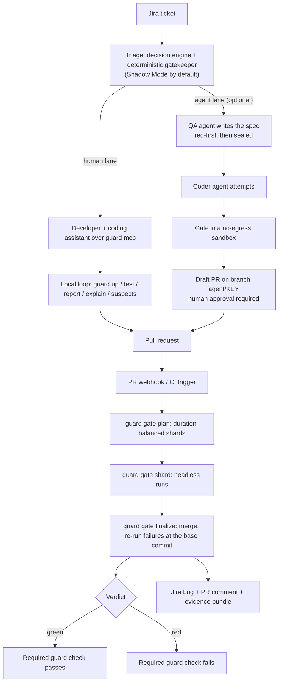

# journeygate

A deterministic end-to-end test gate for pull requests: one CLI, `guard`, that runs your Playwright journeys the same way on a laptop and in CI, and tells a regression from something that was already broken.

[](https://github.com/CarlosBranty/journeygate/actions/workflows/ci.yml)
[](https://github.com/CarlosBranty/journeygate/releases/latest)
[](LICENSE)

```sh
curl -fsSL https://carlosbranty.github.io/journeygate/install.sh | sh
```

```powershell
irm https://carlosbranty.github.io/journeygate/install.ps1 | iex
```

## Why

End-to-end suites are slow, flaky, and cannot tell "this PR broke it" from "it was already broken on main", so teams learn to ignore them. journeygate runs only what a change can affect, re-runs every hard failure against the base commit, and reports a single required `guard` check. Code written by coding agents needs a gate the agents cannot edit, skip or talk their way past; the same gate serves human and agent pull requests alike.

## How it works

The core is a deterministic E2E gate with **no AI** in the verdict. Triage and the agent lane are optional layers on top of it: triage runs in Shadow Mode by default (it only suggests), and the agent lane only opens draft pull requests. Nothing is ever merged automatically.



## Quick start

Install the prebuilt binary (GitHub releases for Linux, macOS and Windows; the checksum is verified):

```sh
curl -fsSL https://carlosbranty.github.io/journeygate/install.sh | sh
curl -fsSL https://carlosbranty.github.io/journeygate/install.sh | sh -s -- --profile qa
```

```powershell
irm https://carlosbranty.github.io/journeygate/install.ps1 | iex
```

Profiles: `cli` (the binary only), `qa` (adds git, Node.js 24 and Playwright Chromium) and `factory` (adds Docker with Compose v2 and gh). The installer asks before it installs anything. While the repository is private, the download needs a token: `curl -fsSL https://carlosbranty.github.io/journeygate/install.sh | GITHUB_TOKEN="$(gh auth token)" sh`. Every option is in [getting-started, section 1](docs/getting-started.md#1-install-guard).

Then run your app as usual and, from the root of its repository (one service or several, with or without Docker Compose):

```sh
guard init                     # detects services, ports and compose infra; asks who runs the app:
                               #   "I start it myself" -> only the URLs; "guard starts it" -> start commands
guard doctor                   # fix every error it lists
guard connect jira             # optional, once per machine: also github, gitlab; --list shows what is set
guard new journey checkout.pay-card --title "Customer pays by card" --smoke
guard up && guard status       # waits for your app (or starts it with runner guard), then shows what runs where
guard test --all               # every journey, headless
guard test                     # day to day: only the journeys your diff affects, plus smoke
```

`--runner self|guard` skips the runner question (`--yes` alone means `guard`). CI always needs start commands: with runner `self` they are kept commented in `target.toml`, ready to uncomment ([getting-started, section 2.4](docs/getting-started.md#24-enable-the-start-commands-for-ci)). `guard init --mcp claude-code --hook --ci github` also registers the MCP server, a pre-push hook and the GitHub workflow.

The full walkthrough (making your app testable, writing journeys, the local loop with a coding agent, and the GitHub workflow with a required `guard` check) is in [`docs/getting-started.md`](docs/getting-started.md).

### Try the service without any account

Fake mode wires a deterministic decision engine, an in-memory Jira (issues come from the webhook payloads) and an in-memory store:

```sh
GUARD_SERVER_TOKEN=dev GUARD_JIRA_WEBHOOK_SECRET=hook guard serve --fake --listen 127.0.0.1:8099
curl -X POST -H 'Authorization: Bearer hook' -H 'Content-Type: application/json'   --data-binary @guard-cli/tests/fixtures/jira_issue_created.json http://127.0.0.1:8099/webhooks/jira
open http://127.0.0.1:8099/decisions        # the Shadow Mode decision for SHOP-7
```

Point the CLI at it with `[server] url = "http://127.0.0.1:8099"` in `target.toml` and the same `GUARD_SERVER_TOKEN`; `guard gate finalize` then posts its gate report and `/guards` shows it.

## Features

| Feature | What it does |
| --- | --- |
| Affected selection | `@smoke` ∪ `@ticket:<KEY>` ∪ journeys whose `paths` globs match the diff ∪ the tree-sitter import graph of `guard-impact`. Any engine failure runs the full suite (fail closed). |
| Baseline classification | `guard gate finalize` re-runs 3/3 failures at the base commit: `regression` (blocks), `pre_existing` (does not block, filed as a bug), `flaky` (blocks when smoke or path-affected), `unavailable` (blocks). |
| Sharding | Duration-balanced shards (LPT: heaviest file first, to the lightest shard). |
| Evidence bundle | Screenshot, trace, video and HTML report uploaded to S3-compatible storage (MinIO, SeaweedFS). |
| `guard suspects` | Lists the commits most likely related to each failing or flaky journey. |
| `guard explain` | Summarises failing and flaky journeys with any Anthropic-compatible Messages API. Output as table, Markdown, JSON or xlsx. |
| `guard repro` | Reruns a remote CI failure locally with the same seed and compares fingerprints. |
| MCP server | `guard mcp` over stdio, 7 tools: `guard_affected`, `guard_test`, `guard_failure`, `guard_repro`, `guard_catalog`, `guard_history`, `guard_map`. Assistants run and read tests; they cannot edit or bypass the gate. |
| Dashboard | Read-only pages served by `guard serve` (decisions, gate results, flaky tests, durations, coverage, agents). |
| Desktop GUI | `guard-gui`, a native egui window over the `guard` binary. Stores API keys in the Windows Credential Manager. Not shipped in releases yet: build it with cargo ([`guard-gui/README.md`](guard-gui/README.md)). |
| Agent lane | Optional: QA writes the spec, red-first, sealed; the Coder attempts; the gate runs in a no-egress sandbox; a draft PR on `agent/<KEY>` waits for human approval. |

### `guard explain` configuration

Only the failure fields of the Playwright report (journey id, title, file, line, status, error message) are sent. The summary defaults to Spanish; pass `--lang en` for English.

```sh
export GUARD_EXPLAIN_API_KEY=...
guard explain --lang en
guard explain --journey checkout.customer-card --lang en --json
```

| Variable | Default | Purpose |
|---|---|---|
| `GUARD_EXPLAIN_API_KEY` | - | API key. Falls back to `ANTHROPIC_API_KEY` when unset. Prefer the guard variable: a user-level `ANTHROPIC_API_KEY` is also read by Claude Code and switches it to API billing. |
| `GUARD_EXPLAIN_BASE_URL` | `https://api.anthropic.com` | Any Anthropic-compatible Messages API (`POST {base}/v1/messages`). |
| `GUARD_EXPLAIN_MODEL` | `claude-haiku-5-5` | Model id; `--model` wins. `--list-models` lists what the provider offers. |
| `GUARD_EXPLAIN_LANG` | `es` | Summary language code; `--lang` wins. |

## Benchmark

`guard-impact` (the import graph behind affected selection and `guard_map`) was compared with CodeGraph v1.6.0 under a decision rule fixed before any data existed, on one repository each for TypeScript (hono), Python (rich), Go (caddy) and Rust (ripgrep):

| Pre-registered macro average | guard-impact | CodeGraph |
| --- | --- | --- |
| Import-edge F1 | **0.981** | 0.520 |
| Impact recall (depth-3 dependents) | **0.955** | 0.866 |
| Impact precision | 1.000 | 0.414 |
| Index build | 0.7–2.3 s | 4.1–11.8 s |
| Depth-3 query | 20–315 µs | 12–31 ms (SDK), about 0.6 s (CLI) |

Caveats, from the report itself:

- One mid-size repository per language. The result holds without the Go repo (F1 0.974 vs 0.631, recall 0.940 vs 0.905).
- guard-impact was later fixed against defects found on these same repositories; the after-fix scores (1.000) are in-sample.
- The ground truth is module-level import resolution, which is guard-impact's design point. CodeGraph is better for symbol-level exploration (callers, callees, call paths) and covers 30+ languages.
- No LLM or paid provider was involved.

Full method, C# and PHP extensions, and threats to validity: [`docs/benchmarks/impact-vs-codegraph.md`](docs/benchmarks/impact-vs-codegraph.md).

## Integrations

| Area | Supported |
| --- | --- |
| Issue tracker | Jira Cloud (the only tracker). |
| Code hosts | GitHub and GitLab: PRs/MRs, commit statuses, comments and draft PRs. They are not used for issue intake. |
| CI | The GitHub Action [`ci/github-action`](ci/github-action/action.yml) and the GitLab component [`ci/gitlab/templates/gate.yml`](ci/gitlab/templates/gate.yml). |
| Agent runtimes | `claude-code`, `codex` and `mini-swe-agent` (admitted); `copilot-cli` and `openhands` (provisional); a scripted `fake` for tests. Runtime and gateway behavior is verified only with fakes and recorded fixtures. |
| Model gateway | LiteLLM, the only egress allowed from agent sandboxes. |
| Decision engine | TypeSafe Jev, optional, proprietary and paid. Without it, triage fails closed to the human lane and affected selection keeps the path rules. |

## CLI reference

Run `guard <command> --help` for every flag. The command surface is in [`docs/contracts/cli.md`](docs/contracts/cli.md).

**Set up**

| Command | Purpose |
| --- | --- |
| `guard init` | Detect how the app runs, then write `target.toml` and the Playwright scaffold. |
| `guard doctor` | Validate configuration and environment. |
| `guard connect jira\|github\|gitlab` | Store credentials per user; `--list` shows what is set. |
| `guard new journey <ID>` | Add a journey to the catalog and create its spec skeleton. |

**Run the app**

| Command | Purpose |
| --- | --- |
| `guard up` / `guard down` | Start the app and wait until it is ready / stop it. |
| `guard status` | PID, liveness and readiness of every service; `--integrations` probes the whole flow. |

**Test and diagnose**

| Command | Purpose |
| --- | --- |
| `guard test` | Run journeys: affected (default), `--all` or `--journey <ID>`. |
| `guard affected` | Print the affected selection without running anything. |
| `guard report` | Open the HTML report of the last run. |
| `guard explain` | Summarise failing and flaky journeys with a model. |
| `guard suspects` | List the commits most likely related to each failure. |
| `guard repro <TEST_ID> --pr <N>` | Reproduce a remote failure locally. |

**CI gate**

| Command | Purpose |
| --- | --- |
| `guard gate plan --shards <N> --out <DIR>` | Write one duration-balanced plan per shard. |
| `guard gate shard --index <I> --plan <DIR>` | Run one shard with the blob reporter. |
| `guard gate finalize --blobs <DIR>` | Merge reports, run the baseline at the base commit, decide and publish the verdict. |

**Services**

| Command | Purpose |
| --- | --- |
| `guard serve` | Webhooks, triage, impact API, gate results and dashboard. |
| `guard mcp` | MCP server over stdio for coding assistants. |

**Agent lane and memory**

| Command | Purpose |
| --- | --- |
| `guard agents check` / `sync` | Validate `agents.toml` / render skills and `AGENTS.md` per runtime. |
| `guard agents run <TICKET>` | Run a ticket through QA and Coder to its PR branch. |
| `guard agents status` / `ab-report` | Queue and run status / the token A/B report of an experiment. |
| `guard memory export --engram <FILE>` | Export the repository's memory facts. |

Exit codes are the same for every command: `0` ok, `1` tests failed or verdict red, `2` usage or config error, `3` environment error.

## Architecture

Shared traits live in `guard-core/src/ports/`; adapters never depend on each other, and only `guard-cli` and `guard-server` wire them together.

| Crate | Role |
| --- | --- |
| `guard-core` | Pure domain rules (selection, verdict, triage, gatekeeper) and the ports. |
| `guard-cli` | The `guard` binary. |
| `guard-impact` | Tree-sitter import graph for TypeScript, JavaScript, Python, Go, Rust, C# and PHP. |
| `guard-jev` | TypeSafe Jev decision engine adapter. |
| `guard-tracker` | Jira Cloud adapter. |
| `guard-codehost` | GitHub and GitLab adapter. |
| `guard-store` | Postgres store and S3 evidence storage. |
| `guard-server` | `guard serve`: HTTP API, webhooks and dashboard (axum). |
| `guard-mcp` | `guard mcp`: the stdio MCP server. |
| `guard-sandbox` | Docker sandboxes and the egress allowlist. |
| `guard-runtimes` | Agent runtime adapters and the LiteLLM client. |
| `guard-agents` | Agent lane: queue, scheduler, QA/Coder pipeline and A/B harness. |
| `guard-map` | The token-budgeted `guard_map` repository map. |
| `guard-gui` | Native desktop window over the `guard` binary. |

| Folder | Contents |
| --- | --- |
| `e2e-playwright/` | Playwright project, journey catalog and tests. |
| `examples/demo-shop/` | Zero-dependency reference app under test. |
| `templates/` | The scaffold `guard init` embeds. |
| `languages/` | Tree-sitter queries per language for `guard-impact`. |
| `agents/` | Skill sources and `AGENTS.md` for the agent lane. |
| `schemas/` | JSON Schemas for `target.toml` and `journeys.json`, with contract tests. |
| `ci/` | GitHub Action, GitLab component and CI tests. |
| `install/` | `install.sh` and `install.ps1`, the release installers. |
| `deploy/` | Images, Compose stack, sandbox image and gateway config. |
| `bench/` | The guard-impact vs CodeGraph benchmark. |
| `docs/` | Getting started, contracts, benchmarks and the architecture proposal. |

### Contracts

`docs/contracts/` is the source of truth for every shared interface.

| Contract | Defines |
| --- | --- |
| [`target-toml.md`](docs/contracts/target-toml.md) | The `target.toml` schema, required fields and defaults. |
| [`journeys-catalog.md`](docs/contracts/journeys-catalog.md) | The catalog format and the tag convention. |
| [`runner-env.md`](docs/contracts/runner-env.md) | Environment, files and exit codes between `guard` and Playwright. |
| [`cli.md`](docs/contracts/cli.md) | The core commands: flags, exit codes and output formats. |
| [`detection.md`](docs/contracts/detection.md) | What `guard init` detects: services, ports, start commands and compose infrastructure. |
| [`demo-app.md`](docs/contracts/demo-app.md) | Routes, selectors and data of the reference app. |
| [`ports.md`](docs/contracts/ports.md) | The shared ports, crate ownership and how later layers change the core commands. |
| [`finalize-phase2.md`](docs/contracts/finalize-phase2.md) | Baseline, evidence and reporting of `guard gate finalize`. |
| [`server-api.md`](docs/contracts/server-api.md), [`mcp-tools.md`](docs/contracts/mcp-tools.md) | `guard serve` HTTP API and environment, and `guard mcp` tools. |
| [`agents-toml.md`](docs/contracts/agents-toml.md), [`sandbox.md`](docs/contracts/sandbox.md), [`qa-coder-protocol.md`](docs/contracts/qa-coder-protocol.md) | Agent lane configuration, sandboxes and the QA/Coder protocol. |

The full design, in Spanish, is in [`docs/propuesta-arquitectura.md`](docs/propuesta-arquitectura.md).

## Self-hosting

You do not need a server to use `guard` as a CLI. To run `guard serve` with Postgres and a SeaweedFS evidence store, plus the LiteLLM gateway and Redis under the `agents` Compose profile, see [`deploy/README.md`](deploy/README.md).

## Development

Requirements: Rust 1.88 (pinned by [`rust-toolchain.toml`](rust-toolchain.toml)), Node 24, pnpm 9; Docker only for `--docker` and the agent lane.

```sh
pnpm install                                        # Playwright suite and demo app
pnpm --filter e2e-playwright exec playwright install chromium
cargo build --release                               # builds target/release/guard

cargo fmt --all -- --check
cargo clippy --workspace --all-targets -- -D warnings
cargo test --workspace

pnpm --filter e2e-playwright run typecheck
pnpm --filter e2e-playwright run lint
pnpm --filter e2e-playwright run test:unit
pnpm --filter e2e-playwright run catalog:lint
pnpm run test:schemas                               # schema contract tests
node --test "examples/demo-shop/test/*.test.mjs"
node --test ci/tests/ci-config.test.mjs             # one file at a time, or "ci/tests/*.test.mjs"
node --test ci/tests/release.test.mjs
node --test ci/tests/install.test.mjs
```

With the binary built, the repository tests itself against the demo app:

```sh
guard doctor
guard up                                            # start the demo app and wait for /healthz
guard test --headed --journey checkout.customer-card
guard test --all
guard report
guard down
```

End-to-end dry run of the agent lane (live Docker and Postgres, fakes for every model):

```sh
GUARD_DOCKER_TESTS=1 \
GUARD_SANDBOX_TEST_IMAGE=<repo>@sha256:<digest of deploy/sandbox/Dockerfile> \
DATABASE_URL=postgres://<user>:<password>@localhost:55432/postgres \
  cargo test -p guard-cli --test agent_lane_e2e -- --include-ignored --nocapture
```

It starts `guard serve --fake` on a copy of `examples/demo-shop`, a fake gateway container (`deploy/litellm/fake-gateway.mjs`), sends a Jira webhook, and checks the sealed spec, the rejected and accepted Coder attempts, egress, the PR branch, spend records, memory facts and `guard_history`.

Releases are cut by pushing a `v*` tag that matches the workspace version ([`release.yml`](.github/workflows/release.yml)).

## Contributing

Issues and pull requests are welcome. Before opening a pull request, run the formatting, lint and test commands above, keep `docs/contracts/` in sync with any interface you change, and use [Conventional Commits](https://www.conventionalcommits.org) for commit messages.

## License

[Apache-2.0](LICENSE).
