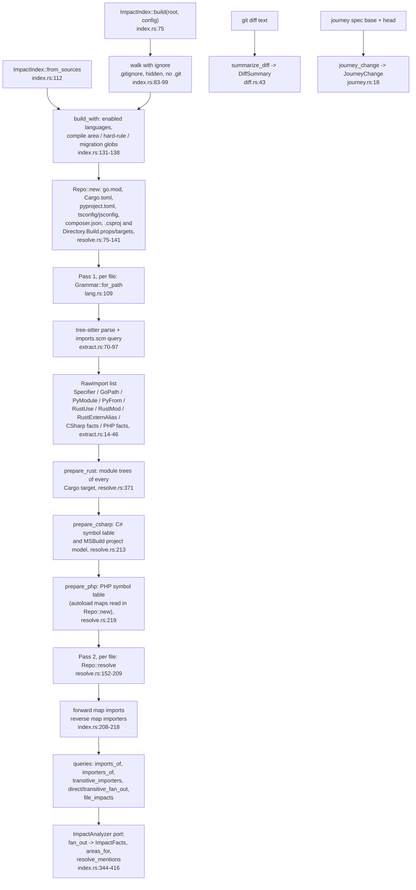

# guard-impact internals

`guard-impact` answers one question: **which repository files depend on this file?** It builds a file-level import graph of a checkout, resolves every import with the rules of its language's toolchain, and turns the reverse graph into the facts the guard needs: fan-out, `target.toml` areas, hard-rule hits, schema migrations, a token-bounded diff summary, and journey-spec change counts.

This guide is for contributors who need to fix a resolver bug or add a language. Every non-obvious claim cites `path:line`. The port contract is in [`contracts/ports.md`](contracts/ports.md) ("Impact analysis semantics"); this document explains how the code meets it.

**Quick path for a resolver bug:**

1. Reproduce it as an in-memory repo in `guard-impact/tests/layouts.rs` and confirm the test fails ([section 10](#10-testing)).
2. Find the resolver for that language in `guard-impact/src/resolve.rs`, `guard-impact/src/csharp.rs` for C#, or `guard-impact/src/php.rs` for PHP ([section 4](#4-languages)).
3. Fix it, then run `cargo test -p guard-impact`, `cargo clippy -p guard-impact --all-targets -- -D warnings` and `cargo fmt --check`.

---

## 1. What it is and what it is not

| It is | It is not |
| --- | --- |
| A **file → file** import graph. An edge means "file A imports the module file B". For C#, which has no file imports, it means "file A names a type declared in file B" ([C#](#c)). For PHP it means "file A names a class declared in B, imports a function or constant declared in B, or statically includes B" ([PHP](#php)). | A symbol graph. There are no functions, call edges or references. CodeGraph does that ([benchmark](benchmarks/impact-vs-codegraph.md#where-codegraph-is-better-and-why-we-keep-it)). |
| **Static.** It reads source text only and never runs code or toolchains. | A build tool. It never evaluates `cfg`, build tags, macros or bundler config. |
| **Synchronous** CPU work over a local checkout. Async callers wrap it in `spawn_blocking` (`guard-core/src/ports/impact_analyzer.rs:3`). | A service. It is a library, built once per process or per run. |
| Limited to the repository. Imports that resolve to no repository file (packages, stdlib) are dropped (`guard-impact/src/resolve.rs:3-4`). | A dependency manager. It never looks inside `node_modules`, `site-packages`, the Go module cache, `~/.cargo` or Composer's `vendor/` ([PHP](#php)). |

**Run-time dependencies it cannot see:** computed `import()` / `require(name)` arguments, `importlib.import_module` / `__import__`, dependency-injection containers, reflection, plugin registries, config-driven routes, templates that name components by string, code generated by macros or build steps, `include!` / `include_str!`, and calls between services over HTTP or queues. This is why the guard still runs the full suite on every PR. Impact analysis only orders the probe and filters local runs ([benchmark](benchmarks/impact-vs-codegraph.md#what-neither-tool-sees)).

### Reused vs ours

Third-party crates do the parsing, the directory walk, glob matching and manifest decoding. Everything that decides *what an import means* is ours.

| Piece | Owner | Where |
| --- | --- | --- |
| Parsers: `tree-sitter` 0.25 plus the TS, JS, Python, Go, Rust, C# and PHP grammar crates | reused | `guard-impact/Cargo.toml:21-30` |
| Directory walk (`ignore`) and glob matching (`globset`), both from ripgrep | reused | `guard-impact/Cargo.toml:11,13` |
| TOML and JSON decoding (`toml`, `serde_json`) | reused | `guard-impact/Cargo.toml:17,20` |
| XML decoding of `.csproj` and `Directory.Build.*` files (`roxmltree`) | reused | `guard-impact/Cargo.toml:15` |
| Query-match iteration (`streaming-iterator`), error derive (`thiserror`), serialization of the public types (`serde`) | reused | `guard-impact/Cargo.toml:16,18,19` |
| Import queries `languages/<lang>/imports.scm` and their capture contracts | **ours** | `languages/*/imports.scm` |
| Capture → raw-import extraction, Rust use-tree expansion, `#[path]` and inline-module scope | **ours** | `guard-impact/src/extract.rs` |
| Per-language resolvers (Node/TS, Python search path, Go packages, Rust module trees) | **ours** | `guard-impact/src/resolve.rs` |
| C# facts (declarations, usings, type references), the MSBuild project model (SDK implicit usings, `<Using>`, `ProjectReference`, `<Compile Include>`) and the symbol table with C# name lookup | **ours** | `guard-impact/src/csharp.rs` |
| PHP facts (declarations, `use` imports, class names, includes), Composer PSR-4 / PSR-0 maps, vendor directories and the PHP symbol table | **ours** | `guard-impact/src/php.rs` |
| `tsconfig`/`jsconfig` loader (JSONC, `extends`, `paths`, `baseUrl`) | **ours** | `guard-impact/src/tsconfig.rs` |
| Cargo target and path-dependency discovery; `pyproject.toml` roots; `go.mod` module path | **ours** | `guard-impact/src/cargo.rs`, `guard-impact/src/resolve.rs:664-734` |
| Two-pass index build, reverse graph, closure, fan-out, areas, hard rules, migrations, mentions | **ours** | `guard-impact/src/index.rs` |
| Diff summary for Jev | **ours** | `guard-impact/src/diff.rs` |
| Journey-spec assertion and skip counting | **ours** | `guard-impact/src/journey.rs` |

---

## 2. Pipeline overview

`summarize_diff` and `journey_change` are free functions. They do not use the graph.

---

## 3. Public API

Everything public is re-exported from `guard-impact/src/lib.rs:26-35`.

### Constants

| Item | Value | Meaning |
| --- | --- | --- |
| `MAX_PARSED_FILE_BYTES` | `2 * 1024 * 1024` (2 MiB) | Larger files are listed but not parsed. Manifests over the cap are not read either, because they go through the same reader (`guard-impact/src/index.rs:25,100-107`). |
| `MAX_MENTION_PATHS` | `200` | Cap on `resolve_mentions` output (`guard-impact/src/index.rs:28`). |
| `MIGRATION_GLOBS` | `**/migrations/**`, `**/migrate/**`, `**/alembic/versions/**`, `**/db/schema.rb`, `**/schema.prisma`, `**/*.sql` | Schema-migration paths (`guard-impact/src/index.rs:15-22`). |
| `MAX_FILES` | `200` | Diff summary files (`guard-impact/src/diff.rs:6`). |
| `MAX_SYMBOLS` | `300` | Diff summary `path#symbol` entries (`guard-impact/src/diff.rs:7`). |
| `MAX_HUNKS` | `40` | Diff summary hunks (`guard-impact/src/diff.rs:8`). |
| `MAX_HUNK_LINES` | `12` | Body lines kept per hunk (`guard-impact/src/diff.rs:9`). |
| `MAX_LINE_CHARS` | `200` | Characters kept per line and per hunk header (`guard-impact/src/diff.rs:10`). |
| `MAX_SUMMARY_JSON_BYTES` | `48_000` | Serialized summary size cap (`guard-impact/src/diff.rs:11`). |

Internal limit: `MAX_EXTENDS_DEPTH = 16` for `tsconfig` `extends` chains (`guard-impact/src/tsconfig.rs:12`).

### Types

| Item | Shape | Notes |
| --- | --- | --- |
| `enum Language { TypeScript, JavaScript, Python, Go, Rust, CSharp, Php }` | Serializes lowercase (`CSharp` → `csharp`) | `Language::ALL`, `name()` (the `[app].languages` name), `from_name(&str)`, `for_path(&str)` by extension, `import_query()` (the embedded `.scm`) (`guard-impact/src/lang.rs:12-81`). |
| `enum AnalysisMethod { Graph, GlobFallback }` | `snake_case` | `GlobFallback`: no enabled plugin for the file. The method depends only on that; fan-out is still read from the graph and is not always 0 ([section 6](#6-fan-out-and-impact)). This covers import targets such as `.css` or `.json` files (`guard-impact/src/index.rs:33-41,327-333`). |
| `struct FileImpact` | `path`, `language`, `method`, `direct_fan_out`, `transitive_fan_out`, `areas`, `human_only`, `schema_migration` | One per changed file (`guard-impact/src/index.rs:45-56`). |
| `struct ImpactIndex` | the graph plus compiled globs | `Clone`, `Send + Sync`, object-safe as `Arc<dyn ImpactAnalyzer>` (`guard-impact/src/index.rs:60-69,739-744`). |

Extension map (`guard-impact/src/lang.rs:112-121`): `.ts .mts .cts` → TypeScript grammar; `.tsx` → TSX grammar (both are `Language::TypeScript`); `.js .jsx .mjs .cjs` → JavaScript; `.py .pyi` → Python; `.go` → Go; `.rs` → Rust; `.cs` → C#; `.php` → PHP (the full grammar, `LANGUAGE_PHP`, so HTML outside `<?php … ?>` parses). A `.csproj` has no plugin; it is read as an MSBuild manifest, together with `Directory.Build.props` / `.targets` ([C#](#c)). `composer.json` has no plugin either; it is read as a manifest ([PHP](#php)). `.phtml` and `.inc` files are not parsed, but an include can target them.

### `ImpactIndex` methods

| Signature | Semantics |
| --- | --- |
| `build(root: &Path, config: &TargetConfig) -> Result<Self, ImpactError>` | Walks and indexes a checkout ([section 5](#5-index-build)). `Err(Io)` if `root` is not a directory, the walk yields an error, or an enabled language's query fails to compile (`Extractor::new`, `:144`). `Err(InvalidGlob)` if an area or `human_only_paths` glob fails to compile (`guard-impact/src/index.rs:75-108,144,475-480`). |
| `from_sources(sources, config) -> Result<Self, ImpactError>` | Same build from `(path, contents)` pairs. Keys are normalized. **No size cap** applies here (`guard-impact/src/index.rs:112-124`). |
| `files() -> impl Iterator<Item=&str>` | Every walked file, sorted, of any language (`:225-227`). |
| `enabled_languages() -> impl Iterator<Item = Language>` | Plugins on (`:230-232`). |
| `fallback_languages() -> &[String]` | `[app].languages` entries with no plugin, such as `java` (`:235-237`). |
| `language_of(path) -> Option<Language>` | The *enabled* plugin for `path` (`:240-242`). |
| `imports_of(path) -> Vec<&str>` | Direct targets, sorted (`:245-253`). |
| `importers_of(path) -> Vec<&str>` | Direct dependents, sorted (`:256-264`). |
| `transitive_importers(path) -> Vec<&str>` | Breadth-first search over `importers`. Each file counts once, the start file is excluded even inside a cycle, and the result is sorted. It is unbounded (`:268-284`). |
| `direct_fan_out` / `transitive_fan_out(path) -> u32` | The lengths of those two lists, saturating at `u32::MAX` (`:286-292,484-486`). |
| `is_schema_migration(path)` / `is_human_only(path) -> bool` | Glob checks on the normalized path (`:294-300`). |
| `file_impacts(changed: &[String]) -> Vec<FileImpact>` | Normalized, deduplicated, sorted by path (`:311-333`). |

### `ImpactAnalyzer` implementation (`guard-impact/src/index.rs:344-416`)

| Method | Returns |
| --- | --- |
| `fan_out(&[String]) -> Result<ImpactFacts, ImpactError>` | `fan_out` is a map of path → **direct** fan-out. `max_fan_out` is the maximum, or 0 when empty. Also `human_only_path_hit`, `human_only_paths` (sorted) and `schema_migration`. It always returns `Ok`; the `Result` is the port's signature (`:337-355`). |
| `areas_for(&[String]) -> Vec<Area>` | Area keys whose globs match any path, sorted and deduplicated (`:357-364`). No production caller outside guard-impact yet; the same is true of `file_impacts`. |
| `resolve_mentions(&[String]) -> Vec<String>` | Ticket module names → repository files, at most `MAX_MENTION_PATHS` ([section 6](#6-fan-out-and-impact)) (`:366-407`). |

### Free functions

| Signature | Section |
| --- | --- |
| `summarize_diff(unified_diff: &str) -> DiffSummary`. Never fails; unknown lines are skipped. | [7](#7-diff-summary-for-jev) |
| `journey_change(path, base_src: Option<&str>, head_src: &str) -> Option<JourneyChange>` | [8](#8-journey-spec-analysis) |

### Errors

`ImpactError` lives in `guard-core/src/ports/impact_analyzer.rs:9-16`. It has two variants:

- `Io(String)`: the root is missing, or the walk failed. A broken `.scm` query is also reported as `Io` with `languages/<lang>/imports.scm: <error>` (`guard-impact/src/extract.rs:57-61`).
- `InvalidGlob(String)`: an area or hard-rule glob failed to compile, reported as `<glob>: <error>`. A failure of the final `GlobSetBuilder::build` carries only the error text, without the `<glob>:` prefix (`guard-impact/src/index.rs:472-480`).

`guard serve` maps `InvalidGlob` to a usage error and `Io` to an environment error (`guard-cli/src/commands/serve.rs:342-345`).

Unparseable sources, non-UTF-8 files, unreadable manifests and invalid TOML or JSON never fail the build. They contribute fewer edges (`guard-impact/src/extract.rs:68-69`, `guard-impact/src/cargo.rs:27-28`, `guard-impact/src/resolve.rs:682-684`).

---

## 4. Languages

### Coverage

| Language | Extensions | An edge from A to B means | Manifests read | Whole-repo step | Tests |
| --- | --- | --- | --- | --- | --- |
| TypeScript / JavaScript | `.ts .tsx .mts .cts`, `.js .jsx .mjs .cjs` | A imports, re-exports, requires or augments module B | `tsconfig.json`, `jsconfig.json` and the JSON files they extend | — | `tests/typescript.rs`, `layouts.rs` |
| Python | `.py .pyi` | A imports module or submodule B | `pyproject.toml` | — | `tests/python.rs`, `layouts.rs` |
| Go | `.go` | A imports the package whose files include B | `go.mod` | — | `tests/go.rs` |
| Rust | `.rs` | A declares `mod` B or `use`s a path inside B | `Cargo.toml` | `prepare_rust` (module trees) | `tests/rust.rs`, `layouts.rs` |
| C# | `.cs` | A names a type declared in B | `.csproj`, `Directory.Build.props` / `.targets` (SDK, implicit usings, `<Using>`, `ProjectReference`, `<Compile Include>`) | `prepare_csharp` (symbol table, project model, global usings) | `tests/csharp.rs`, `layouts.rs` |
| PHP | `.php` | A names a class / interface / trait / enum declared in B, `use function` / `use const` imports a declaration of B, or A statically includes B | `composer.json` | `prepare_php` (symbol table) | `tests/php.rs`, `layouts.rs` |

All six are measured in [section 12](#12-known-limits-and-benchmark-summary): the first four on hono, rich, caddy and ripgrep, C# on dotnet/eShop and PHP on symfony/console.

### Shared extraction rules

- A query capture whose name starts with `_` is a helper and is ignored (`guard-impact/src/extract.rs:89-92`).
- Queries match anywhere in the tree. Imports inside functions, conditionals and `if TYPE_CHECKING:` blocks all count.
- After resolution, `Repo::resolve` removes the importing file itself, so a self-import is never an edge (`guard-impact/src/resolve.rs:207`).
- All internal paths are repo-relative with `/`. `normalize` drops `.` segments and empty segments (so `a//b` and a leading `/` collapse to a repo-relative path), applies `..`, and returns `None` when a path escapes the repo; an escaping import is dropped (`guard-impact/src/resolve.rs:755-767`).

### TypeScript and JavaScript

**Captures.** The contract capture is `@import`: the specifier text without quotes. `@_fn` is a helper.

| Form | `typescript/imports.scm` | `javascript/imports.scm` |
| --- | --- | --- |
| `import … from './x'`, `import type`, `import './x'` | lines 9-10 | lines 8-9 |
| `import x = require('./x')` | lines 13-14 | — (TypeScript syntax only) |
| `export … from './x'`, `export * from` | lines 17-18 | lines 12-13 |
| `require('./x')` with a literal first argument | lines 21-24 | lines 16-19 |
| `import('./x')` with a literal first argument | lines 27-29 | lines 22-24 |
| `declare module '../x' { … }`, relative names only | lines 35-38 | — |

A bare `declare module 'pkg'` is not captured, because it may be an ambient declaration (`languages/typescript/imports.scm:31-34`). Calls such as `require(name)` or `notRequire('./x')` are not captured: the query needs a string literal as the first argument and the `#eq? @_fn "require"` predicate (`languages/typescript/imports.scm:21-24`, `languages/javascript/imports.scm:16-19`; test at `guard-impact/src/extract.rs:327-345`).

**Resolution** (`resolve_node`, `guard-impact/src/resolve.rs:225-241`):

1. **Relative specifiers** are `.`, `..`, `./…` and `../…` (`:212-213`).
   1. Cut at the first `?` or `#`, so `./x?raw` names `./x` (`:217`).
   2. Join with the importer's directory and normalize. A specifier that escapes the repo is dropped (`:218`).
   3. Probe the result with `probe_script`.
2. **Bare specifiers.** `?` and `#` are kept, because `#config` is a subpath-import alias.
   1. Find the governing config with `TsConfigs::for_file`: the nearest directory at or above the file that has a `tsconfig.json` (or a `jsconfig.json` when that directory has no `tsconfig.json`) (`guard-impact/src/tsconfig.rs:95,111-122`).
   2. A nearer config without `baseUrl` or `paths` still governs its files, so the specifier is dropped as a package. The parent config's options never apply (`guard-impact/src/tsconfig.rs:101-104,115`).
   3. Otherwise build candidates (`TsOptions::candidates`, `guard-impact/src/tsconfig.rs:36-54`):
      - First, the substitutions of the best `paths` pattern. An exact pattern wins; otherwise the wildcard with the longest prefix (`best_pattern`, `:59-75`). On a tie in prefix length, `max_by_key` keeps the last candidate (`:73`). Patterns come from a `serde_json` object, and `preserve_order` is not enabled for guard-impact's `serde_json` (only a tree-sitter build dependency enables it), so "last" means alphabetically last by pattern key, not last declared. The `*` text replaces the first `*` of each substitution. Substitutions are relative to `baseUrl` if one is set, else to the directory of the config that declared `paths` (`:39`).
      - Then `baseUrl/<spec>`.
   4. Probe each candidate in order. The first hit wins.
3. **`probe_script(base)`** (`guard-impact/src/resolve.rs:245-264`) tries, in order:
   1. `base` itself.
   2. Emitted-extension rewrites: `.js` → `.ts`, `.tsx`; `.jsx` → `.tsx`; `.mjs` → `.mts`; `.cjs` → `.cts`.
   3. `base` plus each of `.ts .tsx .d.ts .js .jsx .mjs .cjs .mts .cts`.
   4. `base/index` plus each of the same extensions.

   Any repository file matches step 1, not only scripts. `import './s.css'` or `require('./data.json')` therefore creates an edge to that non-script file, which then has importers and a non-zero fan-out (`guard-impact/src/resolve.rs:249,263`).

**Config loading** (`guard-impact/src/tsconfig.rs`):

- Files are parsed as JSONC: BOM, `//` and `/* */` comments, and trailing commas are accepted (`parse_jsonc`, `:201-251`).
- `extends` may be a string or an array. Only relative targets (`./`, `../`) are followed, with `.json` optional. Package names are skipped (`:142-146,190-198`).
- Only two options are tracked: `baseUrl` and `paths`. Each is replaced as a whole, never merged. A later `extends` entry replaces what an earlier one set, and the config's own `compilerOptions.baseUrl` / `paths` replace the inherited value. A child `paths` map replaces the whole inherited map; its patterns are not merged one by one (`:147-184`).
- A cycle or a chain deeper than 16 stops at the repeated (or too-deep) link, which contributes default options. Every config before it in the chain still applies its own options and what it inherited earlier, so `a.json → b.json → a.json` still yields `b.json`'s `baseUrl` (`:133-135`, test at `:294-311`).
- Only files named exactly `tsconfig.json` or `jsconfig.json` govern a directory. `tsconfig.app.json` and similar files are read only when reached through `extends` (`guard-impact/src/resolve.rs:105`, `guard-impact/src/tsconfig.rs:94-95`).
- Only `.json` files are read, and only when TypeScript or JavaScript is enabled (`guard-impact/src/index.rs:161`).

**Not resolved:**

- packages and `node_modules`
- `package.json` `exports`, `imports` (`#x`) and `main`, unless `paths` maps the name
- monorepo workspace packages imported by name, unless `paths` maps them
- `references`, `rootDirs`, `moduleSuffixes`, `typesVersions`
- triple-slash `/// <reference path>`
- `import.meta.glob` and template-literal specifiers

### Python

**Captures** (`languages/python/imports.scm`):

| Capture | Meaning |
| --- | --- |
| `@import` | Dotted module of `import a.b.c` or `import a.b as c` (lines 9-14). |
| `@from` | Module of `from <module> import …`, dotted or relative (`..pkg`) (lines 17-27). |
| `@name` | One imported name of that `from` statement; there is one match per name (lines 19-22). |

`from m import *` yields `@from` with no `@name` (lines 25-27). Whitespace inside the `from` module text is removed (`guard-impact/src/extract.rs:134`).

**Resolution** (`resolve_python`, `guard-impact/src/resolve.rs:324-363`):

- **Module file** (`py_module_file`, `:276-287`): `<path>.py`, then `<path>.pyi`, then `<path>/__init__.py`.
- **Submodule rule** (`py_targets`, `:291-297`): `from M import n` targets M's file **and** `M/n` when `n` is a submodule file.

1. **Relative** (leading dots).
   1. Start at the importer's directory and go up one directory per extra dot. Going above the repo root drops the import (`:313-320`).
   2. `from . import x` (empty rest) targets the package `__init__.py` plus the submodule `x` (`:321-331`).
   3. `from .m import x` targets `m` plus the submodule `m/x`.
2. **Absolute.** Try the search roots in this order and take the **first root that yields any file** (`:338-348`):
   1. **basedir**: the first ancestor directory without `__init__.py`, as for a script or pytest rootdir-prepend (`py_basedir`, `:302-308`)
   2. the repo root `""`
   3. `src`
   4. every root configured by a `pyproject.toml` (`pyproject_roots`, `:666-720`):
      - the project directory and its `src/`, for a non-root `pyproject.toml`
      - `tool.pytest.ini_options.pythonpath` (a list, or a string split on whitespace, `:680`)
      - `tool.setuptools.package-dir.""`
      - `tool.setuptools.packages.find.where`
      - `tool.poetry.packages[].from`

      Roots that escape the repo are dropped by `normalize` (`:717-719`). These roots are **global**: the roots of every `pyproject.toml` in the repo apply to the absolute imports of every Python file, not only to files of that project. They are kept in the sorted order of the manifest paths, without duplicates (`:98-104,339-341`).

**The stdlib is not shadowed.** Package directories around the importer are never roots, so `from abc import ABC` in `rich/console.py` does not resolve to `rich/abc.py` (`guard-impact/tests/layouts.rs:26-46`).

**Not resolved:**

- installed packages and the stdlib
- `__init__.pyi`
- namespace packages without `__init__.py`, when they are not under a root
- `sys.path` edits at run time
- `importlib.import_module` and `__import__`
- parent packages of `import a.b.c`: only the leaf `a/b/c` is an edge; the implicit execution of `a/__init__.py` is not counted

### Go

**Captures:** `@import`, the import path literal with quotes included (`languages/go/imports.scm:6-7`). Quotes and backticks are stripped (`guard-impact/src/extract.rs:116`). Aliased, blank (`_`) and grouped imports all count.

**Resolution** (`resolve_go`, `guard-impact/src/resolve.rs:268-286`):

1. Read `module <path>` from every `go.mod`. `//` comments and quotes are handled (`go_module_path`, `:650-659`). The list is sorted longest module path first (`:110`).
2. Take the first module that equals the import or is a `/`-prefix of it. `ex.com/ab` never matches the module `ex.com/a` (`:255-260`).
3. The package directory is the `go.mod` directory joined with the rest of the path. The import targets **every `.go` file directly in that directory that is not `_test.go`** (`:263-271`). In Go, importing a package depends on all of its files.

`_test.go` files are importers but never targets (`guard-impact/tests/go.rs:9-29`).

**Not resolved:**

- the stdlib and third-party modules
- `go.work`, `replace` directives, `vendor/`
- `import "C"`
- build tags and `GOOS`/`GOARCH`: files for every platform count
- same-package references, which need no import

### Rust

**Captures** (`languages/rust/imports.scm`):

| Capture | Meaning |
| --- | --- |
| `@use` | The argument of a `use` declaration, a use tree (lines 8-9). |
| `@mod` | The name of an **out-of-line** `mod foo;`. `!body` excludes inline `mod x { … }` (lines 11-13). |
| `@extern` | The crate name of `extern crate foo (as bar);` (lines 15-16). |

**Extraction** (`guard-impact/src/extract.rs:149-193`):

- **Use trees** are expanded into one segment list per leaf (`expand_use`, `:262-307`). For example, `use crate::{a::{self, b as c}, d::*}` becomes `[crate,a,self]`, `[crate,a,b]` and `[crate,d]`. A path with generics or macros is skipped (`path_segments`, `:246-259`).
- **Scope**: each import records the inline `mod x { … }` blocks around it, outermost first (`inline_scope`, `:229-242`).
- **`#[path = "…"]`**: read from the outer attributes directly before the `mod` item. Comments and other attributes may sit in between (`path_attribute`, `:200-226`).
- **`extern crate k as a`** emits a `RustUse([k])` (an edge to the crate root) and a `RustExternAlias`. Aliases `_` and `k` itself are ignored (`:163-180`). The query requires `name: (identifier)` (`languages/rust/imports.scm:15-16`), so `extern crate self as x` is not captured.
- **`use ::name`** (leading `::`) loses the `::`: the segment list is just `[name]` (`path_segments`, `:242-255`). It is then resolved like a 2018 uniform path, so a local child module named `name` is tried before the extern crate (`guard-impact/src/resolve.rs:627-633`).

**Cargo model** (`guard-impact/src/cargo.rs`): every `Cargo.toml` with `[package]` becomes a `RustCrate` (`:12-25,52-123`):

- **Lib root**: `[lib] path`, else `src/lib.rs`. **Lib name**: `[lib] name`, else the package name, with `-` replaced by `_` (`:66-75`).
- **Other roots**, kept only if the file exists (`:77-110`):
  - `[[bin]]`, `[[test]]`, `[[example]]` and `[[bench]]` `path`. A target without `path` adds nothing, so a `[[bin]]` without `path` under `autobins = false` does not get Cargo's inferred `src/bin/<name>.rs` (`:84-88`).
  - `src/main.rs` and `src/bin/*.rs` or `src/bin/*/main.rs` (`autobins`)
  - `tests/`, `examples/` and `benches/` conventions (`auto*` switches)
  - `build.rs`, or `package.build`; `build = false` turns it off
- **Path dependencies** come from `[dependencies]`, `[dev-dependencies]` / `[dev_dependencies]` and `[build-dependencies]` / `[build_dependencies]`, plus their `[target.<cfg>.*]` variants (`:144-162`):
  - Each one is keyed by its **dependency key** with `-` replaced by `_`, so `shop = { package = "shop-core", path = … }` is named `shop` (`:192`). A non-renamed dependency is also keyed by its dependency key, not by the target's `[lib] name`; when the two differ, the "any repository lib of that name" fallback still finds it (`guard-impact/src/resolve.rs:588-591`).
  - `x.workspace = true` resolves through the nearest enclosing manifest that has a `[workspace]` table, even when that table has no `[workspace.dependencies]`. There is no fallback to an outer workspace (`:44-48,116-119,189-205`).
- Crates are sorted by the length of their directory string, longest first (`guard-impact/src/resolve.rs:125`). Among the packages whose directory is a prefix of a file's path, the longest is the innermost, so a file belongs to its innermost package.

**Module trees** (`prepare_rust`, `guard-impact/src/resolve.rs:371-450`) run after pass 1, because a `use` needs the `mod` declarations of the whole crate:

1. Roots are processed lib targets first, so a file declared by both a lib and a bin keeps its lib context (`:358-364`).
2. From each root, a depth-first search follows `mod name;` (`rust_mod_target`, `:441-463`):
   - **With `#[path]`**: the path is relative to the declaring file's directory, or, inside `mod x { … }`, to that inline module's directory. The target may be any repository file, whatever its extension (`:457`).
   - **Without `#[path]`**: try `<mod_dir>/<scope>/<name>.rs`, then `<name>/mod.rs`.
3. Inline modules map to the file that holds them (`:401-405`).
4. **Directory ownership**: a `#[path]` file or a `mod.rs` owns its parent directory; any other `x.rs` owns `x/` (`:419-426`).
5. **Orphan files** (no tree reaches them, for example a macro-generated `mod`) are placed by location. The file is modeled under the deepest lib or non-package-dir target root of its package, so `build.rs` never owns the package; otherwise it is a crate root of its own (`rust_context`, `:465-528`).

**`use` resolution** (`resolve_rust_use`, `guard-impact/src/resolve.rs:594-659`). `current` is the file's module path plus the import's inline scope.

1. The first segment selects the base:

   | First segment | Base |
   | --- | --- |
   | `crate` | the crate root (`:593`) |
   | `self` | `current` (`:594-598`) |
   | `super` (repeatable) | `current` with one module popped per `super` (`:599-612`) |
   | any other name | a child module of `current`, if one exists (2018 uniform paths); else an extern crate (`:613-629`) |

2. An extern crate name is looked up in this order:
   1. the target's `extern crate … as` aliases (`:621-625`). Aliases are recorded per module tree, only from files reached from that tree's root (`:389-393`).
   2. a path dependency of the importing package
   3. the package's own lib, which its bins, tests, examples and benches see by name
   4. any repository lib of that name (`rust_extern`, `:549-578`)

   No match drops the import. This covers `std`, `serde` and every other crate outside the repo.
3. A trailing `self` is dropped (`:631-633`).
4. The **longest prefix that names a module file** wins. Module files are looked up in the tree first, then by location (`rust_module`, `:532-543`). The rest of the path names items inside that file (`:635-639`).
5. With no module prefix:
   - an item of the importer's own module resolves to the importer itself, which `resolve` then removes (`:640-643`)
   - anything else resolves to the crate root file, so `use crate::Foo` → `lib.rs` (`:624`)

`mod x;` is itself an edge from the declaring file to `x`'s file (`guard-impact/src/resolve.rs:174-184`).

**Not resolved:**

- **paths used without `use`.** `crate::a::f()` in an expression is not captured; only `use`, `mod` and `extern crate` are.
- macros: `macro_rules!`-generated modules, `include!`
- `cfg` evaluation: every `mod` counts
- re-exports, which are not followed through to the defining file
- `#[path]` on an inline `mod x { … }` block, whose nested out-of-line modules still resolve under `<mod_dir>/x/`
- crates outside the repository

### C#

C# has no file imports: a file uses a type by naming it, and the compiler finds the type in any file of the compilation. An edge therefore means **"file A names a type that file B declares"**. Everything lives in `guard-impact/src/csharp.rs`; the grammar is `tree-sitter-c-sharp` (`guard-impact/Cargo.toml:24`) and the MSBuild files are parsed with `roxmltree` (`guard-impact/Cargo.toml:15`).

**Captures** (`languages/csharp/imports.scm`). The query is flat; the namespace and enclosing types of each capture are read from its ancestors (`Scope::of`, `guard-impact/src/csharp.rs:132-196`).

| Capture | Meaning |
| --- | --- |
| `@declare` | The name of a `class`, `struct`, `interface`, `enum`, `record` (also `record struct`) or `delegate` declaration (lines 23-28). |
| `@program` | A top-level statement. The compiler synthesizes the global `Program` class in the file that holds them, so that file declares `Program` (line 31; `guard-impact/src/csharp.rs:89-90`). |
| `@using` | A using directive: plain, `static`, alias (`using X = A.B;`), each with or without `global` (line 35). |
| `@type` | A node in a type position: any `type:` field (fields, properties, parameters, locals, casts, `new`, `typeof`, `default`, `catch`, declaration and type patterns, `foreach`, constraints, tuple elements, delegates), `returns:`, the right side of `as` / `is`, base lists, generic arguments and explicit interface specifiers (lines 42-58). |
| `@attribute` | An attribute name (line 62). |
| `@expr` | An expression that may name a type: every receiver level of a member access (`Pricing.Rate()`, `Shop.Config.Limits.Max`), a `nameof` argument and a constant pattern (`x is Foo`, `case Color.Red:`) (lines 68-77). |

**Extraction** (`collect`, `guard-impact/src/csharp.rs:80-122`) turns captures into three kinds of `CsFact` (`:18-63`):

- **`Type(full name)`**: the namespace plus the enclosing types plus the name, for example `Shop.Domain.Orders.Order.Line` (`:83-88`). Every part of a partial type emits the same name. A file of top-level statements emits `Program`; with `public partial class Program` in another file, both files declare it.
- **`Using`**: kind (namespace, static, alias), the target with generic arguments dropped, `global`, `rooted` (the target starts with `global::`) and the namespace the directive sits in (`using_directive`, `:198-219`).
- **`Ref`**: the dotted name with generic arguments dropped, its namespace and enclosing types, and two flags. `attribute` is set for an attribute name; `global` is set for a name rooted at `global::` (or another `alias::`) (`dotted`, `:238-261`).
- Array, nullable, pointer and `ref` types yield their element type. Generic arguments, tuple elements and function-pointer signatures are captured on their own. Predefined types (`int`, `string`) and `var` yield nothing (`type_names`, `:224-232`).
- A name whose first segment is a type parameter of an enclosing type, method or local function (`T` in `class Box<T>`) is dropped (`:106-109,145-160`).
- **File-scoped namespaces.** `namespace A.B;` is a sibling of the declarations after it, not their parent, so it applies to every node that starts after it (`:170-184`). This includes the using directives that follow it.

**Project model** (`MsBuildProject`, `guard-impact/src/csharp.rs:321-529`). `Repo::new` reads every `.csproj`, `Directory.Build.props` and `Directory.Build.targets` when C# is enabled (`guard-impact/src/resolve.rs:91-98`, `guard-impact/src/index.rs:152-159`). For each `.csproj`, `load` applies, in order (`:335-353`):

1. the nearest `Directory.Build.props` at or above the project directory, and the ones above it as long as each file mentions `GetPathOfFileAbove` (`build_files`, `:513-529`), outermost first;
2. the `.csproj` itself;
3. the `Directory.Build.targets` chain, found the same way.

From these files it reads (`apply`, `:355-424`):

- the SDK names of the `Sdk` attribute on `<Project>` and of `<Sdk Name="…">` elements, without versions;
- the properties of unconditioned `PropertyGroup`s, skipping conditioned properties. The last definition wins, and `$(Name)` inside the property's own value is expanded;
- the `Using`, `ProjectReference` and `Compile` items of every `ItemGroup`, **conditioned ones included** (recall over precision). Values with `$(…)`, `@(…)` or wildcards are dropped (`plain_values`, `:503-509`).

A project's **global usings** (`global_usings`, `:434-488`) are:

- the SDK's implicit usings when `ImplicitUsings` is `enable` or `true`. Every SDK gets the base set (`System`, `System.Collections.Generic`, `System.IO`, `System.Linq`, `System.Net.Http`, `System.Threading`, `System.Threading.Tasks`). `Microsoft.NET.Sdk.Web` adds `System.Net.Http.Json`, `Microsoft.AspNetCore.{Builder, Hosting, Http, Routing}` and the hosting set. `Microsoft.NET.Sdk.Worker` adds only the hosting set: `Microsoft.Extensions.{Configuration, DependencyInjection, Hosting, Logging}`. `Aspire.AppHost.Sdk` adds `Aspire.Hosting` and `Aspire.Hosting.ApplicationModel`. `UseMaui` adds the MAUI namespaces (`:266-307`);
- `Microsoft.VisualStudio.TestTools.UnitTesting` for `MSTest.Sdk`;
- then the `<Using>` items in order: `Include` (with `Alias` or `Static="true"`), while `Remove` drops an earlier entry with that name.

These usings are fully qualified. The same list is used for the benchmark's Roslyn ground truth (`bench/impact-vs-codegraph/gt_csharp/Program.cs`).

**Symbol table** (`CsIndex::build`, `guard-impact/src/csharp.rs:560-655`). It is built after pass 1 from the facts of every C# file and the project model (`guard-impact/src/index.rs:189-197`, `guard-impact/src/resolve.rs:211-215`); `Repo::resolve` hands each C# file its facts (`guard-impact/src/resolve.rs:187-196`). It holds:

- full type name → every file declaring it, and the set of all proper prefixes of those names, which stands for the namespaces the repository declares, and the set of last segments of those names (`:626-639`);
- **projects**: the directories holding a `.csproj`. A file belongs to the innermost one at or above it (`project_of`, `:658-669`);
- each project's **visible set**: itself plus every project it reaches through `ProjectReference`, transitively (`:580-589,601-612`). A reference counts only when it names a `.csproj` file of the repository;
- each file's **compilations**: its own project plus every project that links it with `<Compile Include>`. A linked file outside any project belongs only to the projects that link it. A file under no project and linked by none has the `None` compilation (`:613-623`). eShop links `src/Shared/*.cs` into the APIs this way;
- the global usings of each compilation: those of the project model, plus every `global using` directive of a file in that compilation (`:595-599,640-648`).

**Resolution** (`CsIndex::resolve`, `guard-impact/src/csharp.rs:698-734`). A file is resolved once per compilation, and the edges are the union (`:707-732`). In a compilation, the visible usings are the file's own non-global directives plus the compilation's global usings (`:708-709`).

1. **Using targets** (`bind_using`, `:755-778`). A directive inside a namespace resolves its target from that namespace outward: in `namespace Shop { using Orders; }` and after `namespace Contoso.Api;`, the target is tried as `Shop.Orders`, then `Orders`, and the first one the repository declares wins. A using namespace must name a declared namespace, a using static a type, and an alias either one. A target that names nothing in the repository (the BCL, packages), a `global::` target and a compilation-unit directive stay as written.
2. `using static T;` and `using X = T;` are themselves edges to `T`. `using A.B;` alone adds no edge (`:722-725`).
3. **Visibility.** A type counts only when one of its declaring files is in a compilation the referencing project can see: the project itself or one it references, or the `None` compilation (`is_visible`, `:680-693`). Files under no project see every type.
4. Each `Ref` follows C#'s lookup order (`resolve_ref`, `:786-841`). A reference none of whose segments is the last segment of a declared type, and whose first segment is no alias, cannot resolve and is skipped before any lookup (`may_resolve`, `:740-749`); most BCL and package names stop there. **The first level with any visible hit wins**:
   1. A `global::` name is looked up only from the global namespace (`:801-803`).
   2. The nested types of the enclosing types, innermost first. `Line` inside `partial class Order` finds `Order.Line` in another part's file (`:804-811`).
   3. Each namespace from the innermost to the global one (`:812-839`). At each level the namespace's own types come first, then the using directives declared in that namespace. This is C#'s order: the global namespace's types come before the compilation-unit usings, as Roslyn binds them. Compilation-unit usings and the global usings sit at the global level. So `[Auditing.Audited]` in `namespace Shop.Domain.Orders` finds `Shop.Domain.Auditing.AuditedAttribute`, and a type of the current namespace wins over a `using`.
   4. **An alias shadows the using namespaces of its level** (`:823-838`). When an alias at that level matches the name's first segment, only the aliases are used. If the alias target is outside the repository, the result is empty, and the using namespaces are not consulted. `using Order = …Queries.Order;` next to a `global using` of the domain namespace binds only the query type.
5. **Fallback.** When a name has no hit in the compilation, it is looked up again without visibility, across the whole repository (`:711-718`). This keeps the edge when the project model is incomplete: references through MSBuild properties, or a `Using` that a target adds. The cost is a false edge when the real binding is a package type.
6. **Through a using** (`through_using`, `:844-868`):
   - An alias replaces the first segment with its target: `using L = Lib;` makes `L.Thing` mean `Lib.Thing`.
   - A using namespace or using static imports only the types directly inside it, not nested namespaces. `A.Sub.Thing` through `using A;` is dropped (`:852-867`).
7. **Longest type prefix** (`lookup`, `:873-892`). A name matches the longest prefix of it that is a declared, visible type; the rest names members. `Pricing.Rate` → `Pricing`, `Order.Line.Max` → `Order.Line`.
8. **Attributes.** `[Foo]` tries `FooAttribute` and `Foo` at each level and keeps both when both exist (`:788-794`).
9. **Ambiguity prefers recall.** Every hit of the winning level counts: two usings that both provide `Item`, one full name declared in two visible projects, `Mark` and `MarkAttribute`. The compiler would report an ambiguity (CS0104), or bind to the one accessible type. guard-impact keeps an edge to every candidate (test `csharp_ambiguous_names_reach_every_candidate` in `guard-impact/tests/layouts.rs`).
10. **Generic arity is ignored.** `Foo<T>` and `Foo` are the same name.

The project-model rules are tested in `guard-impact/tests/layouts.rs`: `csharp_usings_inside_a_namespace_resolve_relative_to_it`, `csharp_top_level_statements_declare_program`, `csharp_implicit_usings_follow_the_project_sdk`, `csharp_project_references_scope_the_symbol_table` and `csharp_a_using_alias_shadows_using_namespace_imports`. The build-file chain is tested by `msbuild_project_reads_the_build_file_chain_and_using_items` in `guard-impact/src/csharp.rs`.

**The BCL is not shadowed.** The BCL and packages declare no repository types, so `Task`, `List`, `Console` and `Attribute` resolve to nothing. A repository type that shares a BCL name is reached only through C# lookup: the fixture's `Shop.Domain.Scheduling.Task` has no importers, because no file imports `Shop.Domain.Scheduling` (test `attributes_generic_arguments_and_bcl_names` in `guard-impact/tests/csharp.rs`). A repository type declared in a namespace of the implicit usings is reached: eShop declares `IEventBusBuilder` in `Microsoft.Extensions.DependencyInjection`, and Web-SDK projects name it without a `using`.

**Over-approximations (recall over precision):**

- A member-access receiver may be a variable, not a type. `order.Total()` resolves to a type named `order` if the repository declares one. When a property shares its type's name (`Color Color`), the edge goes to that same type, so the result is still right.
- Accessibility is not modeled. A referenced project's `internal` type is still visible. On eShop, `Program` in `tests/Ordering.FunctionalTests` reaches both `Ordering.API`'s public partial `Program` and `Identity.API`'s internal top-level `Program`. That gives 2 false edges.
- The repository-wide fallback (resolution step 5) and conditioned items both add edges the compiler might not see.
- The base list, attributes and constraints of a type are looked up as if inside the type, so they also see its nested types.

**Not resolved:**

- In a using target, the usings of the enclosing namespace bodies and of the compilation unit. `using Shop;` followed by `namespace X { using Orders; }` binds `Orders` to `Shop.Orders` in C#, but guard-impact tries only `X.Orders` and `Orders`.
- conditioned properties, such as `ImplicitUsings` set under a `Condition`; `RootNamespace`, `InternalsVisibleTo`, `extern alias` targets
- SDKs other than those listed above, including `Microsoft.NET.Sdk.BlazorWebAssembly` and `Microsoft.NET.Sdk.Razor`, which get only the base set
- the default `<Compile>` glob's exclusions: `<Compile Remove>`, and `bin/` or `obj/` sources
- nested types inherited from a base class (`Base.Nested` used as `Nested` in a derived class)
- extension methods: `x.Ext()` names no type, so the file declaring `Ext` is not an edge
- edges between the parts of one partial type
- source generators, `#if` (every branch counts), and `.razor`, `.cshtml` or `.xaml` files
- `x is A || x is B`: tree-sitter-c-sharp 0.23.5 parses `A || x is B` as one constant pattern, so `A` is dropped (`B` is still captured). Separate statements work.

### PHP

PHP loads classes through an autoloader, not through imports: `use App\Models\User;` only names the class, and the first use of `User` makes Composer load the file. An edge therefore means **"file A names a class, interface, trait or enum that file B declares, imports a function or constant B declares, or statically includes B"**. Everything lives in `guard-impact/src/php.rs`; the grammar is `tree-sitter-php` (`guard-impact/Cargo.toml:27`).

**Captures** (`languages/php/imports.scm`). The query is flat; the namespace of each capture is read from its ancestors and siblings (`namespace_of`, `guard-impact/src/php.rs:137-156`).

| Capture | Meaning |
| --- | --- |
| `@declare` | The name of a `class`, `interface`, `trait` or `enum` declaration (lines 20-23). |
| `@function` / `@const` | The name of a function declaration, and of a `const X = …;` element. A `const` inside a class or enum body is a class constant and is skipped (lines 24-25; `guard-impact/src/php.rs:78-91`). |
| `@use` | A `use` import declaration: plain, aliased, grouped (`use A\{B, C as D}`), `use function`, `use const`, and mixed groups (line 29). |
| `@include` | `require`, `require_once`, `include` and `include_once` (lines 31-36). |
| `@class` | A `name`, `qualified_name` or `relative_name` (`namespace\X`) in a class position: type hints of parameters, returns, properties and `catch` (also inside union, intersection and nullable types), `new`, `extends`, `implements`, trait `use` in a class body, `X::call()`, `X::$prop`, `X::CONST`, `X::class`, `instanceof` and attributes `#[X]` (lines 40-59). |

**Extraction** (`collect`, `guard-impact/src/php.rs:67-114`) turns captures into `PhpFact`s (`:18-31`):

- **`Class`, `Function`, `Const`**: the fully qualified name, the namespace plus the name, without a leading `\`.
- **`Use`**: kind (class, function, const), the fully qualified target, the alias (the last segment without `as`) and the namespace **region** it sits in (`use_imports`, `:176-231`). In a group, a member's own `function` / `const` keyword wins over the declaration's (`:178,224`).
- **`Ref`**: the class name as written, its namespace and region. `self`, `static` and `parent` name no class and are dropped (`:93-105`).
- **`Include`**: the path relative to the including file's directory (`include_path`, `:236-256`). Accepted arguments: a string literal without interpolation, or `__DIR__`, `dirname(__FILE__)` or `dirname(__DIR__[, n])` concatenated with a literal that starts with `/` (`dir_levels`, `:277-307`). `dirname(__DIR__, 2) . '/x.php'` becomes `../../x.php`. Absolute paths, stream wrappers (`phar://`) and computed paths are dropped (`:241`).
- **Namespaces.** A braced `namespace A { … }` is an ancestor. An unbraced `namespace A;` is a sibling of the statements after it, up to the next namespace declaration (`:137-156`). The region id is the start byte of the governing namespace declaration plus one, or 0 for none (`namespace_name`, `:158-164`). `use` imports apply only within their region.

**Autoload maps** (`PhpIndex::load`, `guard-impact/src/php.rs:333-389`). They are read in `Repo::new` from every `composer.json` (`guard-impact/src/resolve.rs:106-110,139`), only when PHP is enabled (`guard-impact/src/index.rs:151`):

- `autoload` and `autoload-dev`, each with `psr-4` and `psr-0`. A prefix maps to one directory or a list of them, relative to the manifest's directory. A directory that escapes the repository is dropped.
- A PSR-4 prefix without a trailing `\` gets one (`:366`). Composer would reject such a manifest.
- **Every** `composer.json` outside a vendor directory counts, so the packages of a monorepo (`packages/billing/composer.json`) resolve relative to their own directory. The maps are global: one package's map applies to the references of every file.
- Each map is sorted by prefix length, longest first, keeping manifest order for equal lengths (`:386-387`). Manifests are processed shallowest first, then by path (`:335`).
- `classmap`, `files` and `exclude-from-classmap` are not read. The symbol table covers classmap code.

**Vendor directories are third-party** (`is_vendor`, `:411-416`). Each honored `composer.json` adds `<its directory>/vendor`, or its `config.vendor-dir` (`:348-354`). When the root has no `composer.json`, the top-level `vendor/` still counts (`:337-339`). A `composer.json` inside a vendor directory is ignored (`:341`), vendor files add no declarations (`:393-408`), and no PHP edge ever targets a vendor file (`:463,484-486`). Vendor files are still walked, listed in `files()` and parsed as importers.

**Symbol table** (`add_declarations`, `:393-408`). It is built after pass 1 from the facts of every `.php` file (`guard-impact/src/index.rs:198-206`, `guard-impact/src/resolve.rs:217-221`). Class and function names are keyed lowercase, because PHP treats them case-insensitively. A constant keeps its name as written and lowercases only its namespace (`const_key`, `:498-503`).

**Resolution** (`PhpIndex::resolve`, `guard-impact/src/php.rs:419-465`). `Repo::resolve` hands each PHP file its facts (`guard-impact/src/resolve.rs:197-206`).

1. **Name to fully qualified name** (`qualify`, `:510-537`), following PHP's rules:
   - `\A\B` is fully qualified.
   - `namespace\A` is relative to the current namespace.
   - Otherwise, when the first segment matches the alias of a class `use` import of the same region (case-insensitively), that segment is replaced by the import's target. `use App\Models as M;` makes `M\Post` mean `App\Models\Post`.
   - Otherwise the current namespace is prepended. There is **no global fallback for class names**: `new Exception()` in `namespace App\Http` means `App\Http\Exception`, as in PHP. Without the leading `\`, a global class is never reached from inside a namespace.
2. **Fully qualified name to file** (`class_files`, `:470-494`). The first match wins:
   1. PSR-4: for each prefix the name starts with, longest first, and each of its directories in order, `<dir>/<rest of the name with \ as />.php`. This is case-sensitive, like the autoloader on a case-sensitive file system.
   2. PSR-0: `<dir>/<namespace with \ as />/<class with _ as />.php`. The prefix stays in the path, so `Legacy_Db_Table` maps to `lib/Legacy/Db/Table.php`.
   3. When neither map names an existing non-vendor file, every file declaring the class (case-insensitive). This covers classmap code and code with no autoloading. It runs only after a PSR miss, so a duplicate declaration elsewhere does not add an edge when the PSR file exists.
3. **`use` imports are edges.** A class `use` resolves its target like a reference. It names the class even when the file uses it only in a docblock (`/** @use HasFactory<UserFactory> */` in the fixture). `use function` and `use const` resolve only to a file that declares that function or constant; anything else (`strlen`, packages) is dropped (`:436-448`).
4. **Includes** are joined with the including file's directory and normalized. They must name a repository file of any extension, so `include 'partials/head.phtml'` is an edge. An escaping or missing path is dropped (`:453-459`).

**Over-approximations (recall over precision):**

- A class `use` import is an edge even when the class is never used.
- A PSR file is trusted without checking that it declares the class.
- When the class is found through the symbol table, every declaring file counts, including conditional declarations and polyfills.

**Not resolved:**

- dynamic names: `new $class`, `$class::make()`, class names in strings, `class_exists`, service-container bindings, Laravel facade aliases, and `config/*.php` arrays that name classes as strings
- function calls without `use function`: a call to a namespaced function of another file, through the namespace fallback, is not an edge. Neither is the `autoload.files` list.
- docblock types (`@param User`, `@var`, `@return`)
- PHP's `include_path` and the current working directory. A relative include resolves only against the including file's directory.
- `.phtml`, `.inc` and other non-`.php` files as importers (they are only targets)
- `use` in closures (`function () use ($x)`), which imports variables, not names

---

## 5. Index build

**Walk** (`ImpactIndex::build`, `guard-impact/src/index.rs:75-108`):

- `ignore::WalkBuilder` with `require_git(false)`: `.gitignore`, `.ignore` and `.git/info/exclude` apply even without a `.git` directory. Hidden files and directories are skipped, and `.git/` is filtered out (`:81-84`).
- The other `WalkBuilder` defaults are kept, so the global git excludes file (`core.excludesFile`) and `.gitignore` files in parent directories above `root` also apply.
- Symlinks are not followed (the crate's default).
- Untracked files that are not ignored **are** indexed: the graph is the working tree, not the git index. `docs/contracts/ports.md` ("Impact analysis semantics") says "every tracked file", which does not match this behaviour.
- Any walk error aborts the build with `Io` (`:86`).
- Only regular files are kept. Paths are made repo-relative with `/` (`:87-96`).

**Reading.** The reader skips files over `MAX_PARSED_FILE_BYTES` and files that are not valid UTF-8 (`read_to_string` fails). Both are still listed in `files()`, so they can be import targets and mention matches (`:98-105`).

**Language enablement** (`enabled_languages`, `guard-impact/src/index.rs:453-466`):

- An empty `[app].languages` list enables every plugin.
- `typescript` also enables `javascript` (`guard-impact/src/lang.rs:58-67`).
- Unknown names go to `fallback_languages`.
- Manifests are read only for enabled languages: `go.mod` for Go, `Cargo.toml` for Rust, `pyproject.toml` for Python, `*.json` for TS/JS, `composer.json` for PHP, and `.csproj`, `Directory.Build.props` and `Directory.Build.targets` for C# (`guard-impact/src/index.rs:147-163`).

**Two passes** (`build_with`, `guard-impact/src/index.rs:126-230`):

1. `Repo::new` reads the manifests (`:164`).
2. **Pass 1**: extract the raw imports of every file of an enabled language (`:166-180`).
3. Build the Rust module trees from the raw imports of all `.rs` files (`:181-188`).
4. Build the C# symbol table and project model from the facts of all `.cs` files and the MSBuild files (`:189-197`).
5. Add the declarations of all `.php` files to the PHP symbol table (`:198-206`).
6. **Pass 2**: resolve each file. The `imports` map stores only files with at least one target, and `importers` is filled as its mirror (`:208-218`).

Rust, C# and PHP need the whole repository before any file resolves, which is why pass 1 runs over every file first. Splitting the passes did not measurably slow the build ([benchmark](benchmarks/impact-vs-codegraph.md#wall-time-after-fixes)).

**Path normalization at the API boundary** (`normalize_input`, `guard-impact/src/index.rs:483-490`):

- `\` becomes `/`, and every leading `./` is stripped.
- `..` and a leading `/` are **not** handled. Callers pass repo-relative paths.

**Determinism.** Identical input gives identical output. For `build`, the input includes ignore files outside the repo (the global git excludes file and parent `.gitignore` files), so two machines with the same checkout can index different file sets. `from_sources` has no such dependency.

- All maps and sets are `BTreeMap` / `BTreeSet`, and every list the API returns is sorted.
- Manifest lists are sorted before use: Go modules (`guard-impact/src/resolve.rs:123`), crates (`:125`), configs (`guard-impact/src/tsconfig.rs:95`).
- When two candidates compete, the first wins, in a fixed order: `or_insert` in the module trees, the first root in the Python search path, the first probe in `probe_script`.

---

## 6. Fan-out and impact

| Concept | Rule | Source |
| --- | --- | --- |
| Fan-out reported to the port | **Direct** importers only. `ImpactFacts.fan_out[path] = direct_fan_out` and `max_fan_out` is their maximum. | `guard-impact/src/index.rs:347-357` |
| Reverse closure | `transitive_importers`: BFS, cycles counted once, start excluded, unbounded. Exposed through `FileImpact.transitive_fan_out`, not through `ImpactFacts`. | `guard-impact/src/index.rs:276-292,333` |
| Areas | `[areas.<key>].paths` globs. A file in two areas gets both. | `guard-impact/src/index.rs:310-316,365-372` |
| Human-only paths | `[hard_rules].human_only_paths`. Any match sets `human_only_path_hit` and lists the path. | `guard-impact/src/index.rs:306-308,351-360` |
| Migrations | `MIGRATION_GLOBS` | `guard-impact/src/index.rs:15-22,361` |
| Fan-out threshold | Not applied here. The Gatekeeper compares `max_fan_out > [hard_rules].max_fan_out_for_agent` (default 10). | `guard-core/src/gatekeeper.rs:131-143`, `docs/contracts/target-toml.md:76` |

Every glob compiles with `literal_separator(true)`, so `*` never crosses a `/`. `infra/*` matches `infra/a.tf` but not `infra/deep/b.tf` (`guard-impact/src/index.rs:472-474,589-608`).

**Glob fallback.** A file has `AnalysisMethod::GlobFallback` when it has no enabled plugin:

- a file of a language without a plugin, such as Java
- a plugin language that `[app].languages` does not enable
- a non-source file such as `infra/deploy.sh`

It still goes through areas, human-only paths and migrations. The method depends only on the extension; `direct_fan_out` and `transitive_fan_out` are read from the graph either way (`guard-impact/src/index.rs:324-336`, `guard-impact/tests/fallback.rs`). Such a file has no imports of its own, but it can be an import target: `import './s.css'`, `require('./data.json')` or a `#[path]` to any file gives it importers, so `file_impacts(["s.css"])` reports `GlobFallback` with `direct_fan_out` 1.

**Deletions and renames.**

- The graph is built from the current checkout, so a deleted path is unknown. The port contract says it has fan-out 0 but still goes through areas, hard rules and migrations (`guard-core/src/ports/impact_analyzer.rs:19-21`).
- No production caller passes a diff or a changed-file list to `fan_out` today. Its only production caller is server triage, which passes `resolve_mentions` output (`guard-server/src/triage.rs:79-80`). That output is drawn from `files()` of the current checkout, so a deleted path never reaches it.
- `git diff --no-renames` (`guard-cli/src/git.rs:211-222`) feeds only `summarize_diff` for Jev, not the graph. `guard affected` lists changed files with `git::changed_files` (also `--no-renames`, `guard-cli/src/git.rs:188-207`) for the catalog's path rules, not for `ImpactIndex`.

**In production, fan-out is a pre-change estimate.** `fan_out` receives the files predicted from a ticket's mentions, not a PR's changed files, so the Gatekeeper fan-out rule judges an estimate made before any code is written (`guard-server/src/triage.rs:76-84`).

**How a change reaches journeys.** guard-impact selects no journeys itself:

- `guard affected` combines the catalog's path rules (guard-core routing) with Jev's impact probabilities.
- Jev is asked about the `summarize_diff` output ([section 7](#7-diff-summary-for-jev); `guard-cli/src/impact.rs:76-79`; ports.md "Phase 2 changes" 1).

**`resolve_mentions`** (`guard-impact/src/index.rs:374-415`) matches each trimmed, normalized mention against `files()`:

1. **By path**: an exact path, or a `/`-suffix (`orders/OrderServiceImpl.ts`). `rders/OrderService.ts` does not match.
2. **By stem**, only when the mention has no `/` and no `.`; a mention with either matches only by path (`:372-376`). The file's stem is the text before its first `.`, and it must equal one of the `stem_variants`: `OrderService`, `order-service`, `order_service`. CamelCase and acronyms are split (`HTTPClient` → `http-client`), and `-`, `_` and spaces also split words (`Order Service` → `order-service`). The comparison is case-sensitive against those three variants, and the file must have an extension (`:377-382,409-439`).
3. **Over 200 hits**: the hard-rule paths (human-only and migrations) are kept first, the rest is filled alphabetically, and the result is re-sorted (`:389-404`). This keeps every rule hit only while there are at most 200 of them; beyond that, `take(MAX_MENTION_PATHS)` drops some rule hits too. The outcome still fails closed, because any one kept hit sets the flag in the later `fan_out` call.

---

## 7. Diff summary for Jev

`summarize_diff` (`guard-impact/src/diff.rs:43-186`) produces the deterministic `DiffSummary` that Jev's impact questions see instead of the raw diff. Jev allows 32k tokens per question and 64k per request, and every cap below keeps the state well inside that budget (`docs/contracts/jev-questions.md:143-154`).

**Parsing:**

- It accepts `diff --git` output and plain `---`/`+++` unified diffs. In a plain diff, each `---`/`+++` pair starts a new file once the current one has counted lines (`:54-92`).
- **Status**: `new file mode` → Added, `deleted file mode` → Deleted, `rename from`/`rename to` → Renamed; `/dev/null` headers set Added or Deleted (`:80-84,94-103`).
- **Path**: a Deleted file is listed under its old path; every other status uses the new path (`:23-28`).
- **`diff --git` paths** are split at the first ` b/`, so a path that itself contains ` b/` is split wrongly. Git's quoted paths (non-ASCII or special characters) are not unquoted (`split_git_paths`, `:212-221`).
- **Binary files** have 0/0 counts. A modified binary is Modified; an added or deleted one carries `new file mode` / `deleted file mode` and is Added or Deleted (`:34,94-97`).
- **Hunks** are read using their `@@` line counts, so a removed line that looks like `--- x` stays in the hunk body (`:105-146,237-250`). `\ No newline` lines are kept.

**What is kept:**

| Output | Content | Cap | Order |
| --- | --- | --- | --- |
| `files` | path, status, additions, deletions | `MAX_FILES` = 200, the alphabetically first | sorted by path, deduplicated (`:165-170`) |
| `symbols` | `path#name` from the `@@` function context and from added or removed **unindented** declaration lines | `MAX_SYMBOLS` = 300 | sorted, deduplicated (`:110-131,171-176`) |
| `hunks` | path, header, body lines | `MAX_HUNKS` = 40 in diff order; `MAX_HUNK_LINES` = 12 body lines each | diff order (`:140-155`) |
| every line and header | text | `MAX_LINE_CHARS` = 200 characters | — (`:203-210`) |
| whole summary | JSON | `MAX_SUMMARY_JSON_BYTES` = 48,000 | over the cap: drop hunks from the end, then symbols, then files (`fit_size`, `:193-201`) |

`truncated = true` whenever anything was cut.

Symbols are collected from every hunk, including hunks beyond `MAX_HUNKS`. `MAX_LINE_CHARS` applies to hunk lines and headers only; file paths and symbols are not cut.

**Symbols.** `declared_symbol` reads an unindented line, skips modifiers, and returns the name after the first keyword that follows them:

- modifiers: `export`, `default`, `async`, `pub`, `pub(crate)`, `pub(super)`, `public`, `static`, `abstract`, `declare`, `unsafe`, `extern`, `final`, `const`
- a declaration keyword: `function`, `function*`, `class`, `def`, `func` (skipping a Go receiver), `fn`, `struct`, `interface`, `enum`, `trait`
- a binding keyword: `type` and `mod` always; `let`, `var` and `const` only when exported

Any other token ends the scan with no symbol. `static` is a modifier, not a binding, so Rust `pub static X` yields no symbol. It is a text heuristic, not tree-sitter (`guard-impact/src/diff.rs:262-331`).

---

## 8. Journey spec analysis

`journey_change(path, base_src, head_src)` (`guard-impact/src/journey.rs:18-33`) reports how one Playwright journey spec changed between the base commit and HEAD.

**The id** is the first `@journey:<id>` tag of HEAD, else of base, so a removed tag still reports its old id. Ids use `[A-Za-z0-9._-]` with trailing dots trimmed. The tag is found by **plain text search**, so a tag inside a comment counts. With no tag in either version, the result is `None` (`:35-51`).

**The counts** come from the syntax tree, so `expect(` inside comments and strings never counts. The grammar is TS, TSX or JS by extension, else TypeScript (`:20-23,59-80`).

| Count | Rule |
| --- | --- |
| assertions | A call whose callee is the identifier `expect`, or the member `expect.poll` / `expect.soft`. In a chained `expect(x).toBe(y)` only the inner `expect(x)` counts (`:82-101`). |
| skips | Any call whose callee is a member with property `skip` or `fixme`, on any object: `test.skip(…)`, `test.describe.fixme(…)`, but also `expect.skip(…)` and non-Playwright APIs (`:95-96`). |

- `base_src = None` means a new file, so `assertions_before = 0`.
- `skips_added = after - before`, floored at 0 (`:31`).
- `file` uses forward slashes.

**Consumer:** `guard gate finalize` step 3 calls `journey_change` for every changed file under `<e2e>/tests/journeys/` (`guard-cli/src/commands/finalize/mod.rs:233-254`).

- Every changed file under that prefix is scanned, whatever its extension (`guard-cli/src/commands/finalize/mod.rs:244-246`).
- It reads the HEAD version with `git show`, falling back to the working tree, and the base version with `git show <base>`.
- When `base_sha` is absent, every spec counts as new (`assertions_before = 0`) (`:250`).
- A deleted spec has no HEAD source and is skipped.
- `guard_core::journey_changes::review` turns the results into the flags shown in PR and Jira comments: assertions decreased, skip/fixme added, journeys changed without a `flow-change` label (`guard-core/src/journey_changes.rs:31-39`).

---

## 9. Where it is used in guard

| Consumer | File | What it asks |
| --- | --- | --- |
| `guard serve` wiring | `guard-cli/src/commands/serve.rs:342-345,373` | Builds one `ImpactIndex` at startup and shares it as `Arc<dyn ImpactAnalyzer>`. It is never refreshed: triage fan-out and agent-lane `predicted_files` use the graph as it was when the process started, while the staleness job rebuilds its own index every run. |
| Triage (server) | `guard-server/src/triage.rs:76-84` | `resolve_mentions(mentioned_modules(issue))`, then `fan_out(paths)` inside `spawn_blocking`. |
| Gatekeeper hard rules | `guard-core/src/gatekeeper.rs:131-143` | Reads `human_only_path_hit`, `schema_migration` and `max_fan_out > max_fan_out_for_agent`. The engine can never override these. |
| Agent lane (scheduler conflicts) | `guard-cli/src/agent_lane/mod.rs:215-218` | `resolve_mentions` gives a ticket's `predicted_files`. The task queue refuses to run two tasks whose predicted files overlap (`guard-agents/src/pg_queue.rs:198,222`). |
| `guard affected` / `guard test --affected` | `guard-cli/src/impact.rs:76-79`, `guard-cli/src/commands/affected.rs:76` | `summarize_diff(git diff --no-renames <merge-base>)` for Jev's impact questions. A git error is an error, never an empty diff. |
| `guard gate finalize` | `guard-cli/src/commands/finalize/mod.rs:233-254` | `journey_change` per changed journey spec. |
| Memory staleness job | `guard-server/src/staleness.rs:205-251`, `guard-cli/src/commands/serve.rs:233` | Rebuilds the index every run (`FanOutSource::Rebuild`) and asks `importers_of(touched)` (direct only). A fact goes stale when a touched file is itself referenced, or when a referenced file directly imports the touched file (`guard-store/src/memory_staleness.rs:216-221`). |
| `guard_map` (MCP) | `guard-map/src/impact_source.rs:33-101`, `guard-cli/src/commands/mcp.rs:485-488` | `files()` filtered by `language_of` gives the nodes; `imports_of` gives the edges. Symbol reads reuse `MAX_PARSED_FILE_BYTES`. This is the default backend, chosen by the benchmark. |
| Benchmark harness | `bench/impact-vs-codegraph/src/lib.rs:26-45` | `bounded_dependents`: a depth-limited BFS over `importers_of`. |

---

## 10. Testing

| Layer | Where | Style |
| --- | --- | --- |
| Unit tests per module | `#[cfg(test)]` in `src/{lang,extract,resolve,csharp,php,tsconfig,cargo,index,diff,journey}.rs` | Pure functions over tiny in-memory inputs. `lang.rs:198-204` compiles every query against its grammars. |
| Fixture mini-repos, one per language | `guard-impact/tests/fixtures/{typescript,python,go,rust,csharp,php,fallback}/`, each with its own `target.toml`. The C# fixture is two projects that `dotnet build` compiles (build a copy outside the repo, so `bin/` and `obj/` never land in it). The PHP fixture is a Laravel-style app (PSR-4 `app/`, factories, classmap seeders, `public/` and `bootstrap/` includes) with a hand-written `vendor/` tree; every file passes `php -l`. | `tests/<lang>.rs` builds them with `common::index(name)`, which calls `ImpactIndex::build` on disk (`guard-impact/tests/common/mod.rs:16-21`), and asserts edges, fan-out, areas and hard rules. |
| Toolchain layouts | `guard-impact/tests/layouts.rs` | In-memory repos via `from_sources`: Python roots, Cargo targets, `#[path]`, `extern crate`, tsconfig `paths`/`baseUrl`/`extends`, C# lookup order, project-scoped global usings and ambiguity, relative using targets, top-level `Program`, SDK implicit usings, `ProjectReference` scoping and alias shadowing, PHP name resolution, PSR-4 / PSR-0, nested `composer.json`, the symbol-table fallback, includes and vendor directories. Most red-first regressions live here. |

**Red-first test for a resolver bug:**

1. Write the smallest repo that shows the bug as a `layouts.rs` test. Use the `index(language, files)` helper (`guard-impact/tests/layouts.rs:11-18`) and assert `imports(&idx, file)` equals what the toolchain would resolve (`tsc`, `importlib`, `go list`, Cargo, the C# compiler's name lookup).
2. Write the assertion message as the rule, not the symptom. For example: "`abc` and `json` are the stdlib; only the relative `.abc` and `rich.text` are repo files" (`guard-impact/tests/layouts.rs:44`).
3. Run `cargo test -p guard-impact --test layouts` and **watch it fail** for the right reason.
4. Fix the resolver. If the fix lives in a helper (`tsconfig.rs`, `cargo.rs`, `pyproject_roots`), add a unit test there too.
5. Run the full gates: `cargo fmt --check`, `cargo clippy -p guard-impact --all-targets -- -D warnings`, `cargo test -p guard-impact`.
6. If the rule is part of the contract, update `docs/contracts/ports.md` ("Impact analysis semantics") and this guide.

---

## 11. How to add a new language

- [ ] **Grammar crate.** Add it to `guard-impact/Cargo.toml` with an exact pin (`=x.y.z`). It must build on `tree-sitter-language` 0.1.x so it loads with `tree-sitter` 0.25 (`guard-impact/Cargo.toml:21-23`). An ABI mismatch shows up as a `set_language` or `Query::new` failure.
- [ ] **Query.** Write `languages/<lang>/imports.scm`. Start it with a capture-contract header like the existing files. Use helper captures prefixed with `_`.
- [ ] **`lang.rs` registration** (`guard-impact/src/lang.rs`):
  - a `Language` variant, plus `ALL`, `name`, `enables` and `import_query` (`include_str!`)
  - a `Grammar` variant, plus `ALL`, the extensions in `for_path`, `language` and `ts_language`
- [ ] **Extraction.** Add a `RawImport` variant if the existing ones do not fit, and a `collect` arm that turns captures into raw imports (`guard-impact/src/extract.rs:14-46,104-195`).
- [ ] **Resolver.**
  - an arm in `Repo::resolve` (`guard-impact/src/resolve.rs:152-209`)
  - a `resolve_<lang>` function that returns only repository files and follows the toolchain's rules in its order
  - manifest discovery in `Repo::new` (`:89-122`), and the manifest's file name in the `manifests` closure, so it is read only when the language is enabled (`guard-impact/src/index.rs:147-163`)
  - a whole-repository step between the passes when a file's targets depend on other files' declarations, like `prepare_rust`, `prepare_csharp` and `prepare_php` (`guard-impact/src/index.rs:181-206`). A large resolver can live in its own module, as `guard-impact/src/csharp.rs` and `guard-impact/src/php.rs` do
- [ ] **Diff symbols (optional).** Add the language's declaration keywords to `declared_symbol` (`guard-impact/src/diff.rs:262-322`). guard-map's `scan_symbols` (`guard-map/src/symbols.rs:33`) is a separate scanner.
- [ ] **Tests.**
  - `lang.rs` extension and name tests
  - an `extract.rs` capture test for every import form
  - a fixture `tests/fixtures/<lang>/` with `target.toml`, plus `tests/<lang>.rs` (edges, stdlib ignored, fan-out, transitive fan-out)
  - `layouts.rs` cases for the toolchain's layout rules
- [ ] **Docs.** Update the plugin list in `guard-impact/src/lib.rs:10-13`, `docs/contracts/ports.md` ("Impact analysis semantics"), and sections 1 and 4 of this guide.
- [ ] **Benchmark.** Add a pinned real repository with a toolchain-grade ground-truth script to `bench/impact-vs-codegraph/`. Report import-edge F1 and depth-3 recall the same way as for the existing four ([Method](benchmarks/impact-vs-codegraph.md#method)).

---

## 12. Known limits and benchmark summary

**Limits** (details in [section 4](#4-languages)):

- Static, file-level, repository-only. None of the run-time dependencies in [section 1](#1-what-it-is-and-what-it-is-not) are seen.
- Rust: only `use`, `mod` and `extern crate` create edges. Inline paths such as `crate::x::f()`, macros and `cfg` are not modeled.
- TS/JS: no `node_modules`, no `package.json` `exports`/`imports`, no project `references`, no triple-slash references.
- Go: no build tags, `go.work`, `replace` or `vendor/`. Every platform's files count.
- Python: no `__init__.pyi`, no run-time `sys.path` edits, no dynamic imports.
- C#: edges are type references, not imports. Lookup is bounded by each project's `ProjectReference` closure, with a repository-wide retry for names that find nothing there. Accessibility is not modeled, ambiguous names reach every candidate, generic arity is ignored, and extension methods and inherited nested types are not seen. Only unconditioned MSBuild properties are read, and only the SDKs listed in [C#](#c) add implicit usings. Benchmark on dotnet/eShop after the fixes: edge F1 0.999, impact recall 1.000. The pre-registered run gave 0.986 and 0.846 (see below).
- PHP: edges are class names, `use` imports and static includes. Dynamic class names, the service container, facades, docblock types and function calls without `use function` are not seen. Composer `vendor/` is never a target. Benchmark on symfony/console: edge F1 1.000, impact recall 1.000 (see below). Includes and `use function` are barely exercised there.
- The graph is the working tree. Deleted files have fan-out 0. Files over 2 MiB and non-UTF-8 files are never parsed.
- `ImpactFacts.fan_out` is direct only (`guard-impact/src/index.rs:349`). The unbounded closure is available through `transitive_importers` and `file_impacts`.
  - **Conflict with the benchmark report:** [impact-vs-codegraph.md](benchmarks/impact-vs-codegraph.md) says in three places (its Method, the depth-3 context table and "Threats to validity") that production `fan_out` counts the unbounded `transitive_importers` set. The code says otherwise; this guide follows the code, and the benchmark text needs fixing.
- The `guard serve` index is built once at startup and goes stale as the checkout changes ([section 9](#9-where-it-is-used-in-guard)).

**Benchmark** ([full report](benchmarks/impact-vs-codegraph.md)). Four pinned repos: hono (TS), rich (Python), caddy (Go), ripgrep (Rust). Ground truth comes from the toolchains (the TypeScript compiler API, `importlib`, `go list`) and a Reference-based Rust resolver.

| Macro average (4 repos) | guard-impact before fixes | guard-impact after fixes | CodeGraph |
| --- | --- | --- | --- |
| Import-edge F1 | 0.981 | **1.000** | 0.520 |
| Depth-3 impact recall | 0.955 | **1.000** | 0.866 |
| Depth-3 impact precision | 1.000 | 1.000 | 0.414 |

The fixes and the per-repo numbers they moved:

| Fix | Repo | Before → after |
| --- | --- | --- |
| Python search path; the stdlib is no longer shadowed | rich F1 | 0.995 → 1.000 |
| Cargo target paths and `extern crate … as` (6 of the 33 missed edges) | ripgrep F1 | 0.930 → 1.000 |
| Cargo target paths and `extern crate … as` | ripgrep recall | 0.820 → 1.000 |
| `declare module` augmentation | hono F1 | 0.998 → 1.000 |
| `declare module` augmentation | hono recall | 0.999 → 1.000 |

`#[path]` support did not move any number: ripgrep has no `#[path]`, and none of the four repos uses it (benchmark "Threats to validity" and "Threats specific to the re-run").

Index build takes about 0.7–1.8 s and a depth-3 query 20–300 µs, against 4–12 s and 12–31 ms for CodeGraph.

The after-fix scores are **in-sample**: the defects were found on these same four repos. Several features are covered only by unit and fixture tests, because none of the four repos exercises them: tsconfig `paths`/`baseUrl`/`extends`, configured Python roots, `#[path]`, `[lib] path`, and renamed or workspace path dependencies ([threats](benchmarks/impact-vs-codegraph.md#threats-specific-to-the-re-run)).

**C# and PHP** ([report section](benchmarks/impact-vs-codegraph.md#c-and-php-2026-11-01)). One pinned repo per language, scored with the same metrics and sampling, under a decision rule fixed per language before the run: if guard-impact's edge F1 or depth-3 recall is lower than CodeGraph's, `guard_map` should prefer CodeGraph for that language. The ground truths are Roslyn's semantic model (C#) and PHP's own lexer with PHP name resolution plus the composer PSR-4/PSR-0 maps (PHP).

| Language (repo) | Edge F1, guard-impact vs CodeGraph | Depth-3 recall, guard-impact vs CodeGraph | Decision |
| --- | --- | --- | --- |
| C# (dotnet/eShop) | **0.986** vs 0.587 | **0.846** vs 0.667 | `guard_impact_better_for_csharp` |
| PHP (symfony/console) | **1.000** vs 0.917 | **1.000** vs 1.000 | `guard_impact_better_for_php` |

So `guard_map` keeps guard-impact for C# and PHP too. The C# run found four defects. Each is now fixed and described in [section 4](#c):

| Defect (pre-registered run) | eShop edges | Metric-2 recall lost, commit-units of 50 | Fix |
| --- | --- | --- | --- |
| top-level-statement `Program` files declared nothing | 7 missed | 5.55 | `@program` capture |
| SDK implicit usings were ignored | 5 missed | 0.17 (one commit) | project model reads the SDK and `ImplicitUsings` |
| the repository-wide table crossed project boundaries | 14 false, 1 missed | 2.00 (three commits) | `ProjectReference` visibility |
| a using alias did not shadow namespace imports | 2 false | 0 | alias-first lookup per level |

The "recall lost" column is recomputed from the pre-registered outputs. It is the recall each defect's missed edges would restore, summed over the 50 commits, out of 7.71 commit-units lost in total. The `Program` defect costs the most: a change to an API's `Program.cs` did not select its functional tests. The project-boundary defect comes second: it emptied the prediction for a change to `src/eShop.AppHost/Extensions.cs` alone. Its cause was the repository-wide table only. The lookup order (global-namespace types before compilation-unit usings) is C#'s own and was kept.

After the fixes, guard-impact's eShop scores are edge F1 0.999 (2 false edges, from the unmodeled accessibility of `internal` top-level `Program`s) and depth-3 recall 1.000 with precision 0.969 ([after fixes](benchmarks/impact-vs-codegraph.md#c-and-php-after-fixes)). These are in-sample: the defects were found on eShop. The PHP plugin did not change. The PHP score is agreement with a ground truth that follows the same prescribed semantics, not proof of correctness, and static includes and `use function` are barely exercised there.
