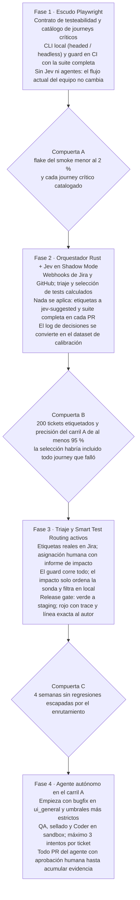
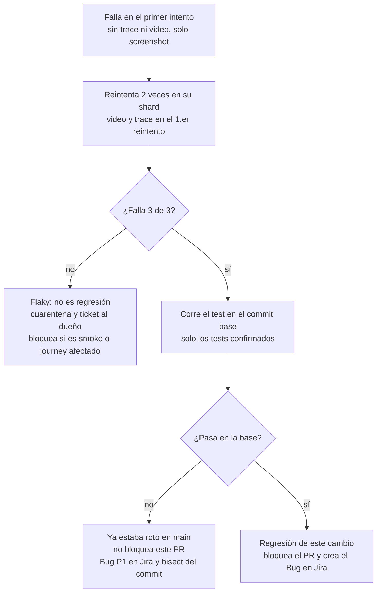
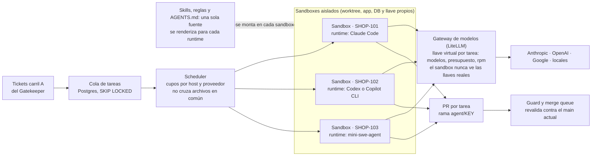

# Plataforma E2E Agéntica — Propuesta de Arquitectura

Oct 31, 2026 · @Carlos Conza

La plataforma es open source, nace desde cero y es agnóstica al lenguaje de la app: prueba desde el navegador y se configura con `target.toml`. Un solo CLI corre los tests en la máquina del dev y en el guard remoto, que ejecuta siempre la suite completa. Jev, Jira y GitHub o GitLab son servicios requeridos; el núcleo que los orquesta es propio y open source, y sus reglas deterministas tienen siempre la última palabra. Verificada contra la API de Jev 1.13, la spec original necesita siete ajustes (sección 2).

## 1. Estructura del monorepo

Un solo repo con dos toolchains (Cargo workspace + pnpm workspace) y arquitectura hexagonal en el orquestador. El dominio no hace I/O, así que el Gatekeeper se prueba con tests unitarios puros. La app bajo prueba vive en su propio repo y la plataforma solo la ve a través de `target.toml`.

```text
e2e-agentdev/
├── Cargo.toml                    # Rust workspace: guard-cli, orchestrator-rust, jev-schemas
├── package.json                  # pnpm workspace root
├── pnpm-workspace.yaml           # e2e-playwright
├── rust-toolchain.toml
├── LICENSE                       # Apache-2.0
├── target.example.toml           # template for guard init; each app repo keeps its own
├── agents.toml                   # runtime, model and budget per agent role
├── agents/skills/                # single source of skills, rendered per runtime
├── contracts/
│   └── testability.md            # what every app under test must expose
├── guard-cli/                    # the guard binary: init, doctor, up, test, repro, gate, serve, mcp
├── languages/                    # tree-sitter import queries, one folder per language
├── deploy/                       # Dockerfile, docker-compose.yml (guard + Postgres + S3/SeaweedFS + LiteLLM)
├── ci/                           # reusable GitHub Action + GitLab CI/CD component
├── plugins/claude-code/          # optional plugin: MCP server + skills + commands
├── orchestrator-rust/
│   ├── src/
│   │   ├── main.rs               # Axum + Tokio bootstrap
│   │   ├── config.rs             # target.toml + thresholds.toml
│   │   ├── domain/               # pure rules, zero I/O
│   │   │   ├── triage.rs         # Triage, Area, Kind
│   │   │   ├── impact.rs         # ImpactFacts, BlastRadius
│   │   │   ├── gatekeeper.rs     # Lane A / Lane B decision
│   │   │   ├── test_routing.rs   # journey selection
│   │   │   └── release_gate.rs   # green/red + 3-retry budget
│   │   ├── app/                  # use cases: triage, test routing, release gate
│   │   ├── ports/                # traits: DecisionEngine, IssueTracker,
│   │   │                         #   CodeHost, SandboxRunner, TestRunner, AgentRuntime
│   │   ├── adapters/
│   │   │   ├── jev/              # reqwest client for api.typesafe.ai
│   │   │   ├── jira/             # REST v3 + webhook signature check
│   │   │   ├── github/           # webhooks, Checks API, PR comments
│   │   │   ├── gitlab/           # webhooks, commit status API, MR notes
│   │   │   ├── impact/           # tree-sitter import graph + ripgrep
│   │   │   ├── sandbox_docker/   # MVP runner; firecracker/ later
│   │   │   └── playwright/       # spawns shards, parses JSON report
│   │   ├── http/                 # /webhooks/{jira,github,gitlab}, /qa-requests
│   │   ├── ui/                   # read-only dashboard, server-rendered
│   │   └── telemetry.rs          # tracing + shadow-mode decision log
│   └── tests/                    # contract tests over recorded Jev fixtures
├── jev-schemas/
│   ├── src/lib.rs                # wire types + question builders
│   ├── questions/
│   │   ├── triage.v1.yaml        # area, kind, risk, checklist
│   │   ├── impact.v1.yaml        # generated: one noul per journey
│   │   └── test-quality.v1.yaml  # secondary anti-cheat signal
│   └── fixtures/                 # recorded responses for offline tests
├── agent-sandbox/
│   ├── images/                   # qa-agent.Dockerfile, coder-agent.Dockerfile
│   ├── policies/                 # mounts + egress per agent role
│   ├── runtimes/                 # AgentRuntime adapters: claude-code, codex, copilot-cli, mini-swe-agent, openhands
│   ├── seal/                     # hashes the QA test before Coder starts
│   └── egress/                   # allowlist proxy (LLM API, registry mirror)
├── e2e-playwright/
│   ├── AGENTS.md                 # conventions every test-writing agent must follow
│   ├── playwright.config.ts
│   ├── catalog/journeys.json     # source of truth for test routing
│   ├── src/
│   │   ├── fixtures/             # test.extend: page objects, data, auth
│   │   ├── pages/                # one Page Object per screen
│   │   ├── flows/                # multi-page steps (cart -> pay)
│   │   └── data/                 # namespaced test-data factories
│   ├── tests/
│   │   ├── setup/auth.setup.ts   # writes .auth/<role>.json
│   │   ├── journeys/             # protected regression, one folder per area
│   │   │   └── checkout/ auth/ inventory/ billing/
│   │   ├── smoke/                # mandatory vital-signs suite
│   │   └── features/             # per-ticket specs written by the QA agent
│   └── scripts/catalog-lint.ts   # catalog and tests must match 1:1
├── .github/
│   ├── CODEOWNERS                # tests/journeys/** owned by QA leads
│   └── workflows/                # guard.yml (the project tests itself), release.yml
└── docs/adr/
```

**`target.toml` es el único punto de acoplamiento con la app.** Vive en la raíz del repo de cada app, lo crea `guard init` y lo valida `guard doctor`. Como todavía no hay stack elegido, los valores son de ejemplo. La referencia completa, con quién define cada campo y cuándo, está en la sección 18.

```toml
# target.toml (excerpt; full reference in section 18)
[app]
name = "shop"
languages = ["typescript", "go"]   # tree-sitter plugins for impact analysis

[areas.checkout]
description = "Cart, payment and order confirmation"   # Jev uses it as the Choice criterion
paths = ["web/src/checkout/**", "services/orders/**"]
sensitive = true                    # always the human lane

[hard_rules]                         # Jev can never override these
human_only_paths = ["**/migrations/**"]
max_fan_out_for_agent = 10
```

**Contrato de testeabilidad** (`contracts/testability.md`). Toda app conectada debe exponer:

- Selectores estables: roles accesibles o `data-testid`, nunca clases CSS.
- `POST /__test__/login` (sesión por rol) y `POST /__test__/seed` (datos con namespace), solo fuera de producción y protegidos por token.
- Un entorno efímero por PR con base de datos propia.
- `GET /healthz`, para que el runner espere a que el entorno esté listo antes de lanzar shards.

## 2. Contrato de datos Rust ↔ Jev AI

Las siete preguntas del triaje viajan en un solo `POST /v1/systemone` contra el modelo fijado `jev-1.13.0`. Rust deserializa la respuesta, la convierte en tipos de dominio y el Gatekeeper decide. Antes del código, estos son los supuestos de la spec que la API real obliga a corregir:

| # | Supuesto en la spec | Qué dice la API de Jev 1.13 | Ajuste en el diseño |
| --- | --- | --- | --- |
| 1 | `Score` de 1 a 5 con umbral `< 2.0` | Los niveles empiezan en 0; `score` es la media ponderada (0.0 a 4.0 con 5 niveles) | Umbral `risk.score < 1.0`, equivalente al nivel 1 de la spec |
| 2 | `confidence > 0.75` en todas las primitivas | `noul` solo trae la probabilidad; `confidence` existe en Choice y Score | La confianza se exige en Choice y Score; en Noul decide la probabilidad misma |
| 3 | Métricas AST (fan-out) dentro del `state` | Jev no cuenta ni compara números de forma fiable | Rust aplica el fan-out como regla dura; a Jev solo le llega un bucket (`isolated`, `moderate`, `wide`) |
| 4 | Jev como guardarraíl anti-trampas | Contenido adversarial en el `state` puede sesgar las respuestas | Anti-trampas determinista primero (sección 4); Jev queda como señal secundaria |
| 5 | Triaje en menos de 150 ms | 70 a 500 ms end-to-end según el proveedor | Timeout de 800 ms, un reintento ante 429/529 y fallback al carril humano |
| 6 | `git diff` crudo en el `state` | Máximo 32k tokens por pregunta y 64k por request | Resumen determinista del diff: archivos, símbolos y hunks recortados |
| 7 | Opciones de Choice en orden fijo | Algunas configuraciones favorecen las primeras opciones | Orden explícito con `IndexMap` y permutaciones durante la calibración |

**Tipos de cable** (`jev-schemas`). Reflejan la forma documentada del request y de la respuesta.

```rust
// jev-schemas/src/lib.rs
use indexmap::IndexMap; // keeps Choice option order explicit (position bias is real)
use serde::{Deserialize, Serialize};
use std::collections::BTreeMap;

/// Pinned on purpose: aliases such as "jev-latest" move between releases.
pub const MODEL: &str = "jev-1.13.0";

#[derive(Serialize)]
pub struct SystemOneRequest<'a, S: Serialize> {
    pub model: &'a str,
    pub state: &'a S,
    pub questions: IndexMap<String, Question>,
}

#[derive(Debug, Clone, Serialize)]
#[serde(tag = "type", rename_all = "lowercase")]
pub enum Question {
    Noul {
        instructions: String,
        #[serde(skip_serializing_if = "Option::is_none")]
        criteria: Option<NoulCriteria>,
    },
    Choice {
        instructions: String,
        /// option name -> description; None = judged by its name alone
        criteria: IndexMap<String, Option<String>>,
    },
    Score {
        instructions: String,
        /// ordered low -> high; level 0 is the lowest
        criteria: Vec<String>,
    },
}

#[derive(Debug, Clone, Serialize)]
pub struct NoulCriteria {
    #[serde(rename = "true")]
    pub when_true: String,
    #[serde(rename = "false")]
    pub when_false: String,
}

#[derive(Debug, Deserialize)]
pub struct SystemOneResponse {
    pub model: String, // resolved version that actually answered
    pub answers: BTreeMap<String, Answer>,
    pub usage: Usage,
}

#[derive(Debug, Deserialize)]
pub struct Usage {
    pub input_tokens: u64,
    pub output_tokens: u64,
}

#[derive(Debug, Deserialize)]
#[serde(tag = "type", rename_all = "lowercase")]
pub enum Answer {
    /// Probability that the statement is true. There is no confidence field.
    Noul { noul: f64 },
    Choice {
        choice: String,
        confidence: f64,
        probabilities: BTreeMap<String, f64>,
    },
    /// Probability-weighted mean of 0-based levels (0.0..=levels-1).
    Score {
        score: f64,
        confidence: f64,
        legend: BTreeMap<String, String>,
        probabilities: BTreeMap<String, f64>,
    },
    #[serde(other)]
    Unsupported, // e.g. "box"; this platform never asks for it
}
```

**Tipos de dominio y `state`.** El dominio nunca ve el JSON de Jev: un `TryFrom<SystemOneResponse> for Triage` falla si falta una respuesta o llega una opción desconocida.

```rust
// orchestrator-rust/src/domain/triage.rs
/// A key of [areas] in target.toml. Areas are data, so the core stays target-agnostic.
#[derive(Debug, Clone, PartialEq, Eq, Hash)]
pub struct Area(pub String);

#[derive(Debug, Clone, Copy, PartialEq, Eq)]
pub enum Kind { Bugfix, MinorFeature, Refactor, Architecture }

#[derive(Debug, Clone)]
pub struct Classified<T> { pub value: T, pub confidence: f64 }

#[derive(Debug, Clone)]
pub struct Triage {
    pub area: Classified<Area>,
    pub kind: Classified<Kind>,
    pub risk: Classified<f64>,          // 0.0..=4.0 for 5 levels
    pub clear_e2e_criteria: f64,        // noul
    pub touches_money_or_security: f64, // noul
    pub agent_suitable: f64,            // noul
    pub changes_existing_flow: f64,     // noul
}

// orchestrator-rust/src/domain/impact.rs
/// Computed in Rust (tree-sitter + target.toml). Jev never sees these numbers.
#[derive(Debug, Clone)]
pub struct ImpactFacts {
    pub max_fan_out: u32,
    pub human_only_path_hit: bool,
    pub schema_migration: bool,
}

#[derive(Debug, Clone, Copy, serde::Serialize)]
#[serde(rename_all = "snake_case")]
pub enum BlastRadius { Isolated, Moderate, Wide } // what Jev does see

impl ImpactFacts {
    pub fn blast_radius(&self) -> BlastRadius {
        match self.max_fan_out {
            0..=3 => BlastRadius::Isolated,
            4..=15 => BlastRadius::Moderate,
            _ => BlastRadius::Wide,
        }
    }
}

// orchestrator-rust/src/adapters/jev/state.rs
#[derive(serde::Serialize)]
pub struct TriageState<'a> {
    pub summary: &'a str,
    pub description: &'a str, // markup and HTML comments stripped first
    pub acceptance_criteria: &'a [String],
    pub mentioned_modules: &'a [String],
    pub blast_radius: BlastRadius,
}
```

**Gatekeeper determinista.** Primero las reglas duras sobre hechos; después las señales calibradas. Las comparaciones negadas fallan cerrado: un `NaN` termina en el carril humano.

```rust
// orchestrator-rust/src/domain/gatekeeper.rs
pub struct Thresholds {
    pub agent_suitable_min: f64,    // 0.80
    pub risk_score_max: f64,        // 1.0 = the spec's "< 2.0" on a 1-5 scale
    pub money_or_security_max: f64, // 0.15
    pub clear_criteria_min: f64,    // 0.70: the QA agent needs testable criteria
    pub confidence_min: f64,        // 0.75, Choice and Score only
    pub existing_flow_max: f64,     // 0.20: intentional flow changes go to a human
    pub max_fan_out_for_agent: u32, // from target.toml
    pub sensitive_areas: HashSet<Area>, // areas with sensitive = true in target.toml
}

#[derive(Debug, PartialEq, Eq)]
pub enum HumanReason {
    HardRulePath, SchemaMigration, FanOutTooWide, SensitiveArea, ArchitecturalKind,
    LowConfidence, RiskTooHigh, MoneyOrSecurity, NotAgentSuitable, UnclearCriteria,
    EngineUnavailable, ShadowMode, ChangesExistingFlow,
}

#[derive(Debug, PartialEq, Eq)]
pub enum Lane { Agent, Human(Vec<HumanReason>) }

pub fn decide(t: &Triage, f: &ImpactFacts, th: &Thresholds) -> Lane {
    use HumanReason::*;
    let c = th.confidence_min;
    let checks = [
        // 1. Hard rules on facts. Jev cannot override any of them.
        (f.human_only_path_hit, HardRulePath),
        (f.schema_migration, SchemaMigration),
        (f.max_fan_out > th.max_fan_out_for_agent, FanOutTooWide),
        (th.sensitive_areas.contains(&t.area.value), SensitiveArea),
        (t.kind.value == Kind::Architecture, ArchitecturalKind),
        // 2. Calibrated signals. Strict comparisons mirror the spec.
        (!(t.area.confidence > c && t.kind.confidence > c && t.risk.confidence > c), LowConfidence),
        (!(t.risk.value < th.risk_score_max), RiskTooHigh),
        (!(t.touches_money_or_security < th.money_or_security_max), MoneyOrSecurity),
        (!(t.agent_suitable > th.agent_suitable_min), NotAgentSuitable),
        (!(t.clear_e2e_criteria > th.clear_criteria_min), UnclearCriteria),
        (!(t.changes_existing_flow < th.existing_flow_max), ChangesExistingFlow),
    ];
    let reasons: Vec<_> = checks.into_iter().filter(|(hit, _)| *hit).map(|(_, r)| r).collect();
    if reasons.is_empty() { Lane::Agent } else { Lane::Human(reasons) }
}

#[test]
fn billing_path_forces_human_even_with_perfect_jev_answers() {
    let facts = ImpactFacts { human_only_path_hit: true, ..isolated_facts() };
    let lane = decide(&perfect_triage(), &facts, &default_thresholds());
    assert_eq!(lane, Lane::Human(vec![HumanReason::HardRulePath]));
}
```

**Cliente y caso de uso.** Cualquier error del motor enruta al humano; la decisión se registra siempre, también en Shadow Mode, porque ese log es el dataset de calibración.

```rust
// orchestrator-rust/src/adapters/jev/client.rs
impl JevClient {
    pub async fn ask<S: Serialize>(
        &self,
        state: &S,
        questions: IndexMap<String, Question>,
    ) -> Result<SystemOneResponse, JevError> {
        let body = SystemOneRequest { model: MODEL, state, questions };
        let res = self.http
            .post(&self.url) // https://api.typesafe.ai/v1/systemone
            .bearer_auth(self.key.expose_secret())
            .timeout(Duration::from_millis(800))
            .json(&body)
            .send()
            .await?;
        match res.status().as_u16() {
            200 => {
                let out: SystemOneResponse = res.json().await?;
                if out.model != MODEL {
                    return Err(JevError::ModelDrift(out.model));
                }
                Ok(out)
            }
            429 | 529 => Err(JevError::Retryable), // one backoff retry upstream, then fail closed
            code => Err(JevError::Rejected(code, res.text().await.unwrap_or_default())),
        }
    }
}

// orchestrator-rust/src/app/triage_ticket.rs
let decided = match jev.ask(&state, triage_questions()).await.and_then(Triage::try_from) {
    Ok(triage) => gatekeeper::decide(&triage, &facts, &thresholds),
    Err(_) => Lane::Human(vec![HumanReason::EngineUnavailable]),
};
decision_log.record(&ticket, &decided).await?;
let effective = if mode.is_shadow() { Lane::Human(vec![HumanReason::ShadowMode]) } else { decided };
```

Con la decisión efectiva, Rust escribe `area:*` y `type:*` en Jira. En Shadow Mode van a un campo aparte (`jev-suggested`), para no ensuciar las etiquetas reales del equipo.

## 3. Catálogo de procesos complejos en Playwright

`catalog/journeys.json` es la fuente de verdad. El guard remoto ejecuta siempre todos los journeys activos (sección 9). La selección por impacto se usa solo en local, con `guard test --affected`, y para la sonda de impacto opcional. Rust lee el catálogo para generar una pregunta Noul por proceso y para elegir qué tags pasarle a Playwright.

```text
remote guard : every active journey, always (shards balanced by duration)
local        : @smoke
             ∪ @ticket:<KEY>                        (the new spec for this ticket)
             ∪ { j : the diff touches j.paths }      (deterministic)
             ∪ { j : impact_noul(j) > 0.25 }        (Jev)
engine down  : run every active journey (fail closed)
```

**Convención de tags**, validada por `scripts/catalog-lint.ts` sobre `npx playwright test --list --reporter=json`:

- `@journey:<id>`: exactamente uno por test de journey; el id es el del catálogo.
- `@area:<area>`: agrupa por área de Jira para corridas manuales.
- `@smoke`: entra en todas las corridas.
- `@ticket:<KEY>`: obligatorio en cada spec que escribe el Agente QA.

**El catálogo.** `impact_question` se redacta como afirmación, porque Noul devuelve la probabilidad de que sea verdadera.

```json
{
  "version": 1,
  "journeys": [
    {
      "id": "checkout.customer-card",
      "area": "checkout",
      "title": "Customer pays by card and gets one confirmed order",
      "impact_question": "This diff can directly or indirectly change how a signed-in customer adds a product to the cart, pays by card and receives an order confirmation.",
      "paths": ["web/src/checkout/**", "services/orders/**", "services/payments/**"],
      "smoke": true,
      "quarantined": false
    },
    {
      "id": "billing.invoice-pdf",
      "area": "billing",
      "title": "Invoice PDF is issued after a paid order",
      "impact_question": "This diff can directly or indirectly change how an invoice is generated or delivered after an order is paid.",
      "paths": ["services/billing/**"],
      "smoke": false,
      "quarantined": false
    }
  ]
}
```

**Configuración.** El filtro vive en TypeScript, donde la semántica de las regex de JS es la que manda. Rust nunca arma regex: solo pasa `E2E_TAGS`.

```ts
// e2e-playwright/playwright.config.ts
import { defineConfig, devices } from '@playwright/test';

const escapeRe = (s: string) => s.replace(/[.*+?^${}()|[\]\\]/g, '\\$&');
// Each selected tag must match a whole tag, so @ticket:SHOP-12 never matches SHOP-123.
const selected = process.env.E2E_TAGS?.split(',').map((t) => new RegExp(`${escapeRe(t)}(?=\\s|$)`));

export default defineConfig({
  testDir: './tests',
  fullyParallel: true,
  forbidOnly: !!process.env.CI,
  retries: process.env.CI ? 2 : 0, // 3 attempts; a pass on retry is reported as flaky, never as clean green
  workers: process.env.CI ? 4 : undefined,
  reporter: process.env.CI ? [['blob'], ['list']] : [['json', { outputFile: 'results/report.json' }]],
  use: {
    baseURL: process.env.TARGET_BASE_URL ?? 'http://localhost:3000',
    testIdAttribute: 'data-testid',
    trace: 'on-first-retry', // heavy evidence only for tests that already failed once
    video: 'on-first-retry',
    screenshot: 'only-on-failure',
  },
  projects: [
    { name: 'setup', testMatch: /setup\/.*\.setup\.ts/ },
    {
      name: 'chromium',
      use: { ...devices['Desktop Chrome'] },
      dependencies: ['setup'],
      grep: selected, // undefined = run everything
    },
  ],
});
```

**Sesión reutilizable.** Un proyecto `setup` genera un `storageState` por rol con login por API, más rápido y menos inestable que pasar por la UI. Si la app guarda el token en `localStorage` en vez de cookies, ese paso se hace una sola vez por UI.

```ts
// e2e-playwright/tests/setup/auth.setup.ts
import { test as setup } from '@playwright/test';

const roles = ['customer', 'admin'] as const;

for (const role of roles) {
  setup(`authenticate as ${role}`, async ({ request }) => {
    const res = await request.post('/__test__/login', {
      data: { role },
      headers: { 'x-test-token': process.env.TEST_API_TOKEN ?? '' },
    });
    if (!res.ok()) throw new Error(`test login failed for ${role}: ${res.status()}`);
    await request.storageState({ path: `.auth/${role}.json` });
  });
}
```

**Fixtures, Page Object y journey.** Los datos llevan un namespace por corrida, test y reintento, así los shards en paralelo nunca comparten registros.

```ts
// e2e-playwright/src/fixtures/index.ts
import { test as base } from '@playwright/test';
import { CartPage } from '../pages/cart.page';
import { CheckoutPage } from '../pages/checkout.page';
import { TestData } from '../data/test-data';

type Fixtures = { data: TestData; cart: CartPage; checkout: CheckoutPage };

export const test = base.extend<Fixtures>({
  data: async ({ request }, use, testInfo) => {
    const ns = `${process.env.RUN_ID ?? 'local'}-${testInfo.testId}-x${testInfo.repeatEachIndex}-r${testInfo.retry}`;
    const data = new TestData(request, ns); // talks to POST /__test__/seed
    await use(data);
    await data.cleanup();
  },
  cart: async ({ page }, use) => use(new CartPage(page)),
  checkout: async ({ page }, use) => use(new CheckoutPage(page)),
});

export { expect } from '@playwright/test';

// e2e-playwright/src/pages/checkout.page.ts
import { expect, type Locator, type Page } from '@playwright/test';

export class CheckoutPage {
  private readonly payButton: Locator;
  private readonly confirmation: Locator;

  constructor(private readonly page: Page) {
    this.payButton = page.getByRole('button', { name: 'Pay now' });
    this.confirmation = page.getByTestId('order-confirmation');
  }

  async payWithCard(card: { number: string; expiry: string; cvc: string }) {
    await this.page.getByLabel('Card number').fill(card.number);
    await this.page.getByLabel('Expiry').fill(card.expiry);
    await this.page.getByLabel('CVC').fill(card.cvc);
    await this.payButton.click();
  }

  async expectOrderConfirmed() {
    await expect(this.confirmation).toBeVisible();
  }
}

// e2e-playwright/tests/journeys/checkout/customer-card.spec.ts
import { test, expect } from '../../../src/fixtures';

test.use({ storageState: '.auth/customer.json' });

test.describe('Checkout: customer pays by card', {
  tag: ['@journey:checkout.customer-card', '@area:checkout', '@smoke'],
}, () => {
  test('creates exactly one confirmed order', async ({ page, data, cart, checkout }) => {
    const product = await data.product({ stock: 3, priceCents: 1999 });
    await page.goto(`/products/${product.slug}`);
    await cart.add();
    await checkout.payWithCard(data.cards.approved);
    await checkout.expectOrderConfirmed();
    expect(await data.ordersFor(product.id)).toHaveLength(1);
  });
});
```

**Invocación desde Rust.** La selección es una función pura del dominio; el adaptador solo lanza procesos.

```rust
// orchestrator-rust/src/domain/test_routing.rs
pub const IMPACT_THRESHOLD: f64 = 0.25;

pub fn select_tags(
    catalog: &Catalog,
    changed_files: &[String],
    impact: Option<&BTreeMap<String, f64>>, // journey id -> noul; None = engine down
    ticket: Option<&str>,
) -> BTreeSet<String> {
    let Some(impact) = impact else { return catalog.all_active_tags() }; // fail closed
    let mut tags = BTreeSet::from(["@smoke".to_owned()]);
    for j in catalog.active() { // quarantined journeys run in a separate, non-blocking job
        let by_path = changed_files.iter().any(|f| j.paths.is_match(f)); // globset::GlobSet
        let by_jev = impact.get(&j.id).is_some_and(|p| *p > IMPACT_THRESHOLD);
        if by_path || by_jev {
            tags.insert(format!("@journey:{}", j.id));
        }
    }
    if let Some(key) = ticket {
        tags.insert(format!("@ticket:{key}"));
    }
    tags
}

// orchestrator-rust/src/adapters/playwright/runner.rs
let status = tokio::process::Command::new("npx")
    .args(["playwright", "test", format!("--shard={shard}/{total}").as_str()])
    .env("E2E_TAGS", tags.iter().cloned().collect::<Vec<_>>().join(","))
    .env("TARGET_BASE_URL", &preview_url)
    .env("RUN_ID", &run_id)
    .current_dir(&e2e_dir)
    .status()
    .await?;
```

En CI, el pipeline del equipo corre `guard gate` en tres pasos (`plan`, `shard`, `finalize`). El YAML para GitHub Actions y GitLab CI está en la sección 12.

## 4. Sandbox anti-trampas (prevención de reward hacking)

Los permisos se imponen con montajes y red, no con prompts. Un agente puede ignorar una instrucción, pero no puede escribir en un volumen montado en solo lectura. El runtime (Claude Code, Codex, Copilot CLI, mini-swe-agent u OpenHands) es el loop del agente; la frontera de seguridad es el contenedor (sección 16).

**Secuencia del carril A:**

1. **Agente QA** (contenedor nuevo) escribe `tests/features/<KEY>.spec.ts` usando Playwright MCP contra el entorno preview. Es la única ruta escribible.
2. **Red-first:** el orquestador corre ese spec contra el commit base, sin cambios. Debe fallar; si pasa, el test no prueba nada nuevo y vuelve al QA o al humano. Corre en un sandbox de chequeo: un contenedor nuevo de la misma imagen, sin montajes del host, sin red de salida y con el árbol candidato copiado dentro.
3. **Sellado:** el orquestador guarda el spec y su SHA-256 fuera del sandbox.
4. **Agente Coder** (otro contenedor nuevo) recibe el spec sellado en solo lectura y solo puede escribir en rutas de código de la app.
5. **Extracción:** el orquestador toma únicamente el diff del Coder y lo rechaza si toca algo fuera de las rutas permitidas.
6. **Gate:** aplica el diff sobre un checkout limpio, superpone el spec sellado desde su propio almacenamiento y corre la selección de la sección 3, en otro sandbox de chequeo como el de red-first. Nunca ejecuta tests desde el workspace del Coder.
7. **PR:** si el gate pasa, el orquestador crea la rama `agent/<KEY>`, la empuja y abre o actualiza un PR (o MR) en borrador con la etiqueta `agent`. Sin `[code_host]` o sin token, la rama queda solo en local. Nunca hace merge.

**Matriz de permisos:**

| Recurso | Agente QA | Agente Coder | Orquestador (gate) |
| --- | --- | --- | --- |
| Código de la app | Lectura | Escritura | Lectura |
| `tests/features/<KEY>.spec.ts` | Escritura hasta el sellado | Solo lectura | Lectura y verificación de hash |
| `tests/journeys/**`, `tests/smoke/**` | Lectura | Sin acceso; recibe solo el trace de lo que falló | Lectura desde copia confiable |
| `playwright.config.ts`, `src/fixtures/**`, snapshots | Lectura | Solo lectura | Lectura |
| `package.json`, lockfile, CI, `target.toml` | Sin acceso | Solo lectura | Lectura |
| Secretos (Jira, Jev, GitHub o GitLab, producción) | Ninguno | Ninguno | Único portador |
| Red de salida | Gateway de modelos (llave virtual) y entorno preview | Gateway de modelos (llave virtual) y mirror de paquetes | Los chequeos (red-first y gate) corren sin salida; el orquestador sí sale para publicar el PR |
| `git push` | No | No | Sí, como autor del commit |

Que el Coder no vea los journeys es deliberado: no puede ajustar el código a tests que no conoce. Agregar dependencias queda fuera del carril A.

**Calidad del test, determinista primero** (tree-sitter sobre el spec, antes de consultar a Jev):

- Al menos un `expect` por test, y ninguno trivial como `expect(true).toBe(true)`.
- Sin `test.skip`, `test.fixme`, `.only` ni `waitForTimeout`.
- Sin `page.route` que simule la propia API de la app: mockear el sistema bajo prueba anula el E2E.
- Sin `try/catch` que trague fallos de aserción, y con el tag `@ticket:<KEY>` presente.

Recién después se consulta el Noul `test_has_meaningful_assertions`, con los comentarios del spec eliminados del `state`. Por debajo del umbral, el ticket pasa a revisión humana.

**Trampas del Coder en el código de la app.** Un escáner del diff deriva al humano si encuentra:

- Detección del entorno de prueba: `navigator.webdriver`, `process.env.CI`, variables de Playwright o user-agent sniffing.
- Valores del seed o `data-testid` usados en lógica de negocio.
- Validaciones eliminadas o puenteadas en rutas de auth, permisos o pagos.

**Aislamiento:**

- **MVP:** Docker rootless con filesystem raíz `--read-only`, `--cap-drop=ALL`, `no-new-privileges`, volúmenes por rol y red interna con proxy de egress por allowlist. gVisor (`runsc`) donde esté disponible.
- **Producción:** microVMs Firecracker. Requieren Linux con KVM, así que en desarrollo sobre Windows se queda Docker.
- Contenedor nuevo por intento, destruido al terminar. Presupuesto por ticket: 3 intentos del Coder, con tope de tiempo y de tokens; después, carril humano con el reporte completo.

## 5. Hoja de ruta de implementación (MVP en 4 fases)



Las fases 1 a 3 no cambian cómo trabaja el equipo: agregan señales y bloqueos medidos. El agente entra recién cuando el log de Shadow Mode demuestra que el triaje acierta; si una compuerta no se cumple, se sigue en la fase anterior.

## 6. Riesgos técnicos críticos y mitigación

Los tres riesgos de la spec van primero; los otros tres salieron de verificar la API de Jev y el diseño del sandbox.

| Riesgo | Cómo se detecta | Mitigación |
| --- | --- | --- |
| Tests inestables (flaky) | Playwright marca `flaky` el test que pasa al reintentar; tasa por test en una ventana de 50 corridas | Dos reintentos en CI, 3 intentos en total. Un flaky en un journey elegido por el diff cuenta como rojo. Fuera del diff y por encima del 2 %, el orquestador lo marca `quarantined` en el catálogo (job no bloqueante) y abre un ticket al dueño. `@smoke` nunca entra en cuarentena: si es inestable, bloquea. Lint contra `waitForTimeout` |
| Colisión de datos en paralelo | Fallos que solo aparecen con más de un worker; stock o conteos incorrectos | Namespace por corrida, test y reintento. Cada test crea sus propios datos por `/__test__/seed` y nunca reutiliza un registro compartido. Base de datos por entorno preview, limpieza idempotente y emails únicos por namespace |
| Calibración inicial de umbrales | En Shadow Mode, predicción de Jev contra la etiqueta final que deja el humano en Jira | Umbrales en `thresholds.toml`, no en código. Diagrama de confiabilidad por pregunta. Umbral del carril A elegido por precisión de al menos 95 %, aunque baje el volumen. Opciones de Choice permutadas. Golden set de 200 tickets reejecutado ante cualquier cambio de modelo |
| Journey afectado no seleccionado | Solo en local: el guard remoto corre todo, así que el riesgo queda en el feedback temprano del dev | Unión con rutas deterministas y smoke. Regresión completa cada noche. Cada escape agrega la ruta al `paths` del journey |
| Prompt injection en el ticket | Texto del ticket que intenta orientar al clasificador ("es un cambio trivial") | Las reglas duras sobre rutas dominan. HTML y comentarios fuera del `state`. El sandbox no tiene secretos: lo peor posible es un PR que el gate rechaza |
| Jev caído, lento o con deriva de versión | Respuestas 429/529, timeouts o un `model` distinto del fijado | Timeout de 800 ms y un reintento. Fallback a carril humano y suite completa. Alerta ante deriva de versión |
| Dependencia de un servicio propietario (Jev) | Caída, latencia o cambios de API o de precio de TypeSafe | Fail closed: triaje al carril humano y suite completa. Modelo fijado con alerta de deriva. Fakes del puerto para probar el núcleo sin red |
| Guard remoto lento con la suite completa | Tiempo de pared del gate que crece con cada journey nuevo | Shards por duración, app por shard, primera pasada liviana y confirmación solo de los fallos (sección 9) |
| Datos sensibles en la evidencia | Screenshots, videos o traces que muestran datos reales | Seed solo con datos sintéticos, URLs firmadas con vencimiento y retención limitada en el storage (sección 11) |
| Test debilitado al actualizar un flujo | Menos aserciones, un skip nuevo o un journey modificado sin ticket flow-change | El guard lo marca en el PR y en Jira; QA aprueba vía CODEOWNERS; el healer nunca corre en el remoto (secciones 13 y 14) |
| Costo descontrolado de agentes en paralelo | Gasto diario del gateway por encima de lo previsto | Llave virtual con presupuesto y vencimiento por tarea, tope diario global y máximo 3 intentos (sección 16) |
| Dos agentes editan los mismos archivos | Conflictos de merge entre PRs de agentes | El scheduler no paraleliza tareas con archivos en común; la merge queue revalida contra el main actual |
| Agente externo fuera de nuestro sandbox (Copilot en la nube) | PR abierto por un agente que no corrió con nuestros montajes ni nuestro egress | El guard aplica las mismas reglas: rechaza cambios en tests, superpone el spec sellado y marca el PR como externo (sección 16) |

## 7. Open source y multi-lenguaje

La plataforma no depende del lenguaje de la app, porque prueba desde afuera: navegador y HTTP. Lo único que sí depende del lenguaje es el análisis de impacto, y se resuelve con plugins de tree-sitter.

| Pieza | ¿Depende del lenguaje de la app? | Cómo se resuelve |
| --- | --- | --- |
| Tests E2E | No: hablan con el navegador y con HTTP | Siempre en TypeScript, sea la app Go, Java, Python, PHP o Rust |
| Levantar la app | Sí | Comandos `start` y `ready` declarados en `target.toml` |
| Datos de prueba y login | No | Contrato HTTP (`/__test__/seed`, `/__test__/login`) con implementaciones de referencia por framework |
| Análisis de impacto | Sí | Un plugin por lenguaje: grammar de tree-sitter + `languages/<lang>/imports.scm` + un fixture que lo prueba |
| Lenguaje sin plugin | — | Cae a los globs de `target.toml`: menos preciso, pero nunca roto |

**Los tests se escriben solo en TypeScript**, aunque Playwright tenga bindings para Python, Java y .NET. El sharding, los tags, los proyectos con dependencias y `merge-reports` son del runner `@playwright/test`, que solo existe en Node. Los otros bindings usan pytest, JUnit o NUnit, y habría que reimplementar todo eso por cada uno.

**Núcleo propio, servicios externos requeridos.** El núcleo que orquesta es código propio y open source: CLI, orquestador, Gatekeeper, reparto de shards, clasificación de fallos y reportes. Sobre él se usan tres servicios externos, todos requeridos:

- **Jev** (TypeSafe, pago): triaje, impacto y señal anti-trampas. Requiere `TYPESAFE_API_KEY`.
- **Jira** (Atlassian): ingesta de tickets y reporte de regresiones.
- **GitHub o GitLab:** código, webhooks y estado del pipeline. Los dos adaptadores existen desde el inicio (sección 12).

Los puertos `DecisionEngine`, `IssueTracker` y `CodeHost` se mantienen, pero no para reemplazar a Jev o a Jira. Sirven para probar el núcleo con fakes, sin pagar llamadas ni depender de la red. La licencia sugerida es Apache-2.0, la misma de open-jev, que además incluye una concesión explícita de patentes.

## 8. CLI local y servidor

Un solo binario en Rust, `guard` (nombre provisional), cubre los dos casos. El dev lo usa en su máquina antes del merge y el servidor lo usa en CI o como servicio. Lo que corre en local con `--docker` es exactamente lo que corre el guard remoto.

**Instalación.** Los instaladores y los binarios por plataforma salen de GitHub Releases, generados con cargo-dist. Las URLs son de ejemplo.

```sh
# macOS / Linux
curl -fsSL https://<org>.github.io/guard/install.sh | sh

# Windows (PowerShell)
irm https://<org>.github.io/guard/install.ps1 | iex

# Node projects: the npm package downloads the prebuilt binary
npm i -D @<org>/guard

# Server: guard + Postgres (decision log) + S3/SeaweedFS (evidence) + LiteLLM (model gateway); see deploy/README.md
docker compose -f deploy/docker-compose.yml up -d --build --wait
```

**Comandos:**

| Comando | Qué hace | Dónde |
| --- | --- | --- |
| `guard init` | Detecta los lenguajes del repo y crea `target.toml` y `e2e/` con un journey de ejemplo | Local, una vez |
| `guard doctor` | Verifica Node, navegadores, Docker, la app levantada y los endpoints del contrato | Local y CI |
| `guard up` / `guard down` | Levanta y baja la app con los comandos de `target.toml` | Local y CI |
| `guard test` | Corre tests: `--affected` (default), `--all`, `--journey <id>`, `--headed`, `--ui`, `--debug`, `--docker` | Local |
| `guard gate` | Pipeline del guard en tres pasos (plan, shard, finalize): suite completa, baseline y reporte (sección 12) | CI |
| `guard serve` | Webhooks de Jira y GitHub, triaje y orquestación del sandbox de agentes | Servidor |
| `guard report` | Abre el reporte HTML o el trace de la última corrida | Local |
| guard agents sync | Renderiza las skills y AGENTS.md para cada runtime (sección 16) | Local y servidor |
| guard repro \<test-id> --pr \<n> | Baja la evidencia de un fallo del guard y lo reproduce con la misma imagen y semilla (sección 17) | Local |
| guard mcp | Servidor MCP para que el asistente de IA del dev corra y lea los tests (sección 17) | Local |

**Con pantalla o headless:**

- **Local, por defecto headless.** `--headed` abre el navegador visible, `--ui` abre el UI Mode de Playwright y `--debug` el Inspector. Se pasan tal cual a Playwright.
- **Local con `--docker`:** corre dentro de la imagen oficial de Playwright, con los mismos navegadores y fuentes que el guard. Siempre headless, y es el único modo válido para comparar screenshots.
- **Servidor:** siempre headless.

**Flujo típico del dev antes del merge:**

```sh
guard up
guard test                                              # affected journeys + smoke, headless
guard test --headed --journey checkout.customer-card    # watch one journey run
guard test --all --docker                               # exactly what the remote guard runs
```

`--affected` compara `main...HEAD` más el working tree y usa la misma `select_tags` de la sección 3. No sirve `--only-changed` de Playwright: solo mira los archivos de test y lo que esos tests importan, y un test E2E no importa el código de la app.

**Clave de Jev en local.** Como Jev es obligatorio, `--affected` también lo consulta en la máquina del dev. Si `target.toml` apunta a un `guard serve`, el CLI le pide el análisis al servidor, que guarda la única clave. Si no, usa `TYPESAFE_API_KEY` del entorno. Sin ninguna de las dos, corre todos los journeys en vez de adivinar.

**Dos formas de desplegar el servidor:**

1. **CI nativo (recomendado para empezar):** `guard gate` dentro de GitHub Actions o GitLab CI. No hace falta un servidor. Lo único que no cubre es la ingesta desde Jira (etapas 01 y 02).
2. **Servicio:** `guard serve` recibe los webhooks de Jira y GitHub, corre el triaje, orquesta el sandbox y dispara los gates en CI.

## 9. Suite completa rápida en el guard remoto

El guard remoto corre siempre todos los journeys activos. Jev ya no decide qué se ejecuta, y eso elimina el riesgo de dejar afuera un journey afectado. El tiempo total depende de tres términos, y se ataca cada uno:

```latex
T_{gate} \approx T_{arranque} + \frac{\sum_i d_i}{S \cdot W} + T_{confirmacion}
```

Acá, d\_i es la duración de cada test, S la cantidad de shards (máquinas) y W los workers por máquina. Ejemplo ilustrativo: 2.000 tests de 20 s suman 40.000 s de trabajo; con 10 máquinas de 4 workers son unos 1.000 s (≈ 17 min) más el arranque. Ese divisor solo se cumple si la app aguanta la carga, y por eso cada shard levanta la suya.

| Palanca | Qué recorta | Cómo |
| --- | --- | --- |
| Shards balanceados por duración | El shard más lento, que define el total | Playwright reparte por cantidad de tests, no por duración. El orquestador guarda la duración histórica de cada archivo y reparte con LPT |
| App y base de datos por shard | La app como cuello de botella y los choques de datos | Cada máquina corre `guard up` con su propia app y DB; la capacidad crece con los shards |
| Workers según núcleos | CPU ociosa | `workers` medido por máquina; solo Chromium en el gate y el resto de navegadores en la corrida nocturna |
| Primera pasada liviana | Grabar trace y video de tests que pasan | `trace` y `video` en `'on-first-retry'`: el primer intento no graba nada pesado; solo el reintento de un test que falló graba (sección 10) |
| Setup por API | Logins y altas por UI repetidos | `storageState` por rol y seed por HTTP; la UI solo en el journey que la prueba |
| Terceros bloqueados | Analytics, chats y CDNs externos | `page.route` aborta los dominios listados en `target.toml`, y de paso quita ruido |
| Imagen precalentada | Instalar navegadores y dependencias en cada corrida | Imagen oficial de Playwright con versión fijada y caché de `node_modules` |
| Sonda de impacto (opcional) | Tiempo hasta la primera señal | Un shard extra corre solo los journeys afectados y avisa en minutos; la suite completa sigue en paralelo y es la que decide |

**Reparto por duración.** Con la convención de un journey por archivo, balancear archivos es casi tan fino como balancear tests. Los archivos nuevos, sin historial, entran con la mediana.

```rust
// orchestrator-rust/src/domain/shard_plan.rs
/// Longest-processing-time first: heaviest file goes to the currently lightest shard.
pub fn plan_shards(mut files: Vec<(String, Duration)>, shards: usize) -> Vec<Vec<String>> {
    files.sort_by(|a, b| b.1.cmp(&a.1));
    let mut bins: Vec<(Duration, Vec<String>)> = vec![(Duration::ZERO, Vec::new()); shards];
    for (file, d) in files {
        let lightest = bins.iter_mut().min_by_key(|(load, _)| *load).expect("shards > 0");
        lightest.0 += d;
        lightest.1.push(file);
    }
    bins.into_iter().map(|(_, files)| files).collect()
}
```

```ts
// e2e-playwright/playwright.config.ts (excerpt)
// testMatch globs are matched against absolute paths, so the plan stores "**/<relative path>".
const plan = process.env.GUARD_SHARD_PLAN
  ? (JSON.parse(readFileSync(process.env.GUARD_SHARD_PLAN, 'utf8')) as { files: string[] })
  : undefined;

export default defineConfig({
  testMatch: plan?.files ?? '**/*.spec.ts',
  // ...rest of the config from section 3
});
```

## 10. Determinismo: cuándo algo se rompió de verdad

Un E2E nunca es 100 % determinista: hay red, tiempo y un navegador real. La estrategia tiene dos partes: eliminar las fuentes de ruido conocidas y confirmar cada fallo antes de llamarlo regresión.



Los 3 intentos separan lo inestable de lo roto. La corrida contra la base separa lo que rompió este cambio de lo que ya estaba roto, y solo eso bloquea el PR.

**Video solo para lo que falla.** Playwright no puede empezar a grabar cuando un test ya falló, así que el video sale del reintento. Con `retries: 2` y `video: 'on-first-retry'`, el primer intento no graba nada. Solo el primer reintento de un test que falló graba video y trace, y un test que pasa nunca paga ese costo.

Conviene evitar `'retain-on-failure'`: graba todos los tests y después descarta los que pasaron. El reporte JSON ya clasifica cada test: `flaky` si pasó en un reintento y `unexpected` si falló los 3 intentos. Con `[evidence] video = "off"` en `target.toml` queda solo screenshot y trace.

**Fuentes de ruido y cómo se controlan:**

| Fuente de ruido | Control |
| --- | --- |
| Navegador, fuentes y sistema operativo distintos | Imagen oficial de Playwright con versión fijada, igual en local (`--docker`) y en el guard |
| Fecha, hora y zona horaria | `timezoneId` y `locale` fijos; `page.clock.setFixedTime()` en los tests que dependen de la fecha |
| Aleatoriedad del frontend | `Math.random` reemplazado por un generador con semilla derivada del test; una reejecución reproduce el mismo azar |
| Animaciones | `reducedMotion: 'reduce'`; `toHaveScreenshot` ya desactiva animaciones y oculta el cursor por defecto |
| Datos compartidos | Namespace por test y repetición, y base de datos por shard (sección 9) |
| Servicios externos | `page.route` bloquea terceros; las pasarelas de pago van en modo sandbox o con respuestas grabadas (`routeFromHAR`) |
| Esperas arbitrarias | Solo aserciones web-first y `expect.poll`; `eslint-plugin-playwright` prohíbe `waitForTimeout` |
| Orden entre tests | `fullyParallel: true` obliga a que cada test sea independiente |

```ts
// e2e-playwright/playwright.config.ts (excerpt): one fixed environment everywhere
retries: process.env.CI ? 2 : 0, // attempt 1 is lean; attempts 2 and 3 only exist for failed tests
use: {
  timezoneId: 'UTC',
  locale: 'en-US',
  viewport: { width: 1280, height: 720 },
  deviceScaleFactor: 1,
  colorScheme: 'light',
  reducedMotion: 'reduce',
  screenshot: 'only-on-failure',
  trace: 'on-first-retry',
  video: process.env.GUARD_VIDEO === 'off' ? 'off' : 'on-first-retry',
},

// e2e-playwright/src/fixtures/index.ts (excerpt): seeded Math.random, seed shown in the report
page: async ({ page }, use, testInfo) => {
  const seed = [...testInfo.testId].reduce((h, c) => (h * 31 + c.charCodeAt(0)) >>> 0, 7);
  await page.addInitScript((s) => {
    let x = s;
    Math.random = () => (x = (x * 1664525 + 1013904223) % 4294967296) / 4294967296;
  }, seed);
  testInfo.annotations.push({ type: 'seed', description: String(seed) });
  await use(page);
},
```

Los screenshots de referencia (`toHaveScreenshot`) solo se generan y se comparan en modo `--docker`. Fuera del contenedor, las fuentes del sistema cambian los píxeles y el test mentiría.

## 11. Evidencia y reporte en Jira

Cada fallo confirmado produce un paquete de evidencia. Las capturas van adjuntas al ticket de Jira; lo pesado (trace y video) va a un storage compatible con S3 y se enlaza.

**Qué se captura** (en el primer reintento del test que falló):

- Screenshot del momento del fallo.
- Trace (`trace.zip`) con DOM, red, consola y cada paso. Se abre con `https://trace.playwright.dev/?trace=<url firmada>`, lo que exige CORS habilitado en el bucket.
- Video del primer reintento: solo existe para tests que fallaron.
- Error, paso y línea exacta (`file:line` del reporte JSON), semilla aleatoria y commit.
- Resultado de los 3 intentos y de la corrida contra la base.

En modo servicio, el storage es el MinIO del `docker-compose`. Las URLs son firmadas y vencen, y la retención es limitada: un screenshot puede mostrar datos, por eso el seed usa solo datos sintéticos.

**Llamadas a Jira Cloud (REST v3):**

| Momento | Llamada | Para qué |
| --- | --- | --- |
| Regresión confirmada nueva | `POST /rest/api/3/issue` | Crea un Bug con el fingerprint como label, vinculado al ticket del cambio |
| Mismo fallo ya reportado | Búsqueda JQL por el label del fingerprint | Comenta la nueva ocurrencia en el Bug existente, sin duplicar |
| Hay capturas | `POST /rest/api/3/issue/{key}/attachments` | Adjunta los PNG; exige el header `X-Atlassian-Token: no-check` y el campo multipart `file` |
| Fin del gate | `POST /rest/api/3/issue/{key}/comment` | Resumen en Atlassian Document Format: resultados, línea exacta y links al trace y al reporte |

El ticket del cambio sale del nombre de la rama o del título del PR (`SHOP-123-fix-cart`). Si no hay ticket, el resumen queda solo en el PR. El fingerprint es un hash del id del test más el mensaje de error normalizado (sin números ni ids), así el mismo fallo siempre cae en el mismo Bug.

```rust
// orchestrator-rust/src/adapters/jira/attachments.rs
let part = reqwest::multipart::Part::bytes(png)
    .file_name("checkout-customer-card.png")
    .mime_str("image/png")?;
let form = reqwest::multipart::Form::new().part("file", part);

self.http
    .post(format!("{}/rest/api/3/issue/{key}/attachments", self.base_url))
    .basic_auth(&self.email, Some(self.api_token.expose_secret()))
    .header("X-Atlassian-Token", "no-check")
    .multipart(form)
    .send()
    .await?
    .error_for_status()?;
```

El mismo paquete vuelve a la etapa 03: al Agente Coder como entrada de su siguiente intento, o al humano con la línea exacta del fallo.

## 12. Integración con GitHub Actions y GitLab CI

El guard vive dentro del pipeline que el equipo ya tiene. El mismo binario corre en GitHub Actions y en GitLab CI en tres pasos, y el resultado vuelve como estado obligatorio del PR o del MR. En los dos casos el job solo necesita Docker: `guard` lanza Playwright dentro de la imagen oficial fijada y la app con docker compose.

1. **`guard gate plan --shards N`:** lee las duraciones históricas y escribe un plan por shard como artefacto.
2. **`guard gate shard --index i`:** cada job levanta su propia app con `guard up`, corre su parte en headless y sube su reporte `blob`. Sale con código 0 aunque haya tests en rojo: solo falla por errores de infraestructura.
3. **`guard gate finalize`:** junta los reportes, corre los tests que fallaron 3 de 3 contra el commit base, sube la evidencia, reporta en Jira y publica el veredicto. Es el único paso que decide.

**Por dónde entra un PR.** Todo PR va directo al guard desde el pipeline, sin pasar por el triaje. El triaje decide quién desarrolla un ticket de Jira, y un PR ya está desarrollado. El orquestador participa por un costado: lee la clave de Jira de la rama o del título para saber si el ticket es `flow-change`, calcula el impacto para la sonda y recibe el resultado para reportarlo. Los PR sin ticket, como un hotfix o una actualización de Dependabot o Renovate, también pasan la suite completa: una dependencia actualizada es una fuente clásica de regresiones. Un pedido de QA antes de producción corre el mismo pipeline de forma manual, contra el entorno indicado.

| Plataforma | Qué bloquea el merge | Dónde queda el resultado |
| --- | --- | --- |
| GitHub | `finalize` publica un check run, y la branch protection lo marca como requerido | Check y comentario en el PR, más Jira |
| GitLab | La regla "Pipelines must succeed" del proyecto | Commit status y nota en el MR, más Jira |

**GitHub Actions.** Se distribuye como action reutilizable que instala el binario.

```yaml
# .github/workflows/guard.yml
name: guard
on: pull_request

jobs:
  plan:
    runs-on: ubuntu-latest
    steps:
      - uses: actions/checkout@v4
      - uses: <org>/guard-action@v1
      - run: guard gate plan --shards 8 --out plan/
      - uses: actions/upload-artifact@v4
        with: { name: shard-plan, path: plan/ }

  shard:
    needs: plan
    runs-on: ubuntu-latest
    strategy:
      fail-fast: false
      matrix:
        index: [1, 2, 3, 4, 5, 6, 7, 8]
    steps:
      - uses: actions/checkout@v4
      - uses: <org>/guard-action@v1
      - uses: actions/download-artifact@v4
        with: { name: shard-plan, path: plan/ }
      - run: guard gate shard --index ${{ matrix.index }} --plan plan/
      - uses: actions/upload-artifact@v4
        with: { name: blob-${{ matrix.index }}, path: e2e-playwright/blob-report/ }

  finalize:
    needs: shard
    if: always()
    runs-on: ubuntu-latest
    steps:
      - uses: actions/checkout@v4
        with: { fetch-depth: 0 }   # the baseline run needs the base commit
      - uses: <org>/guard-action@v1
      - uses: actions/download-artifact@v4
        with: { pattern: blob-*, path: all-blobs/, merge-multiple: true }
      - run: guard gate finalize --blobs all-blobs/
        env:
          TYPESAFE_API_KEY: ${{ secrets.TYPESAFE_API_KEY }}
          JIRA_API_TOKEN: ${{ secrets.JIRA_API_TOKEN }}
          GUARD_STORAGE_URL: ${{ secrets.GUARD_STORAGE_URL }}
          GITHUB_TOKEN: ${{ secrets.GITHUB_TOKEN }}
```

**GitLab CI.** Se distribuye como componente del catálogo de CI/CD. Los shards usan `parallel`, y GitLab entrega `CI_NODE_INDEX` empezando en 1. Hace falta un runner con Docker-in-Docker, que exige modo privilegiado.

```yaml
# .gitlab-ci.yml, using the published component
include:
  - component: $CI_SERVER_FQDN/<group>/guard-ci/gate@1.0.0
    inputs:
      shards: 8

# What the component expands to (simplified)
stages: [plan, shard, finalize]

variables:
  DOCKER_HOST: tcp://docker:2375   # dind service: guard runs Playwright and the app here
  DOCKER_TLS_CERTDIR: ""

default:
  image: ghcr.io/<org>/guard:1     # guard binary + Docker CLI
  services: [docker:dind]

guard:plan:
  stage: plan
  script: guard gate plan --shards 8 --out plan/
  artifacts: { paths: [plan/] }

guard:shard:
  stage: shard
  parallel: 8
  script: guard gate shard --index $CI_NODE_INDEX --plan plan/
  artifacts:
    when: always
    paths: [e2e-playwright/blob-report/]

guard:finalize:
  stage: finalize
  when: always
  variables: { GIT_DEPTH: 0 }   # the baseline run needs the base commit
  script: guard gate finalize --blobs e2e-playwright/blob-report/
```

Los reportes `blob` no chocan al juntarse porque Playwright les pone un hash en el nombre. Los secretos (`TYPESAFE_API_KEY`, `JIRA_API_TOKEN`, `GUARD_STORAGE_URL` y el token de GitLab) van como variables enmascaradas del proyecto. Sin `guard serve`, el historial de duraciones que usa `plan` se guarda en la caché del pipeline.

## 13. Cómo se escriben los tests

Los tests son código TypeScript en el repo, y no hace falta construir un editor: Playwright ya trae las herramientas. Un editor propio que guarde tests en una base de datos crearía una segunda fuente de verdad, separada del código que prueba.

| Forma | Herramienta | Para quién |
| --- | --- | --- |
| Grabando | `npx playwright codegen <url>`; en VS Code, Record new, Record at cursor y Pick locator | QA o devs que quieren el esqueleto rápido |
| Agentes de Playwright (1.56+) | `npx playwright init-agents --loop=claude`: planner (plan en Markdown), generator (tests) y healer (repara fallos) | Devs que parten de los criterios del ticket |
| Agente QA de la plataforma | Playwright MCP dentro del sandbox (sección 4) | Tickets del carril A |
| A mano | Page Objects y fixtures de la sección 3 | Lógica compleja o journeys críticos |

**Flujo recomendado:**

1. El ticket de Jira trae criterios de aceptación verificables (Noul `clear_e2e_criteria` alto).
2. Un agente genera el borrador: el plan en Markdown y el spec.
3. El dev lo ajusta con codegen o a mano y abre el PR.
4. `catalog-lint`, los chequeos anti-trampas de la sección 4 y la revisión humana lo aprueban.

**Convenciones para los agentes.** `e2e-playwright/AGENTS.md` les dice que usen los Page Objects de `src/pages`, los fixtures de `src/fixtures`, los tags del catálogo y datos por seed, y que nunca usen selectores CSS ni `waitForTimeout`. Sin ese archivo, los agentes escriben tests que funcionan pero se saltean la arquitectura. Las definiciones de `init-agents` se regeneran en cada actualización de Playwright.

**La regla del healer.** Si el checkout se rompió de verdad, lo más fácil para un agente que repara tests es aflojar la aserción y tapar el bug. Por eso:

- El healer nunca corre en el guard remoto.
- En local solo propone cambios, que van a un PR.
- Si toca `tests/journeys/**` o `tests/smoke/**`, lo aprueba QA vía CODEOWNERS (sección 14).

## 14. Cambios intencionales de un flujo

Si un requerimiento cambia un flujo a propósito, el journey que lo prueba va a fallar, y eso no es una regresión. Esos tickets van siempre a un dev humano, que actualiza el test en el mismo PR con aprobación de QA. El Agente Coder nunca toca journeys (sección 4).

| Tipo de cambio | Ejemplo | Quién actualiza el test | Cómo lo detecta la plataforma |
| --- | --- | --- | --- |
| Sin cambio de flujo | Un bugfix que no altera el checkout | Nadie: los journeys deben seguir verdes | Si uno falla 3 de 3 y pasa en la base, es regresión |
| Cambio intencional de un flujo | El checkout agrega un paso de confirmación | Dev humano, en el mismo PR, con aprobación de QA | Triaje: Noul `changes_existing_flow`. Guard: journey modificado en el PR |
| Flujo nuevo | Un proceso de devoluciones | Dev o Agente QA: journey nuevo más su entrada en el catálogo | `catalog-lint` exige la entrada en `journeys.json` |
| Flujo eliminado | Se retira el pago con cupón | Dev: borra el journey y su entrada, con aprobación de QA | `catalog-lint` y CODEOWNERS |

**En el triaje.** Una pregunta Noul nueva, `changes_existing_flow`, evalúa la afirmación "este ticket cambia a propósito cómo funciona un proceso que ya existe". Desde 0.20, el ticket va al carril B y recibe la etiqueta `flow-change` en Jira. El informe para el dev ya lista los journeys que probablemente tenga que actualizar. El Gatekeeper de la sección 2 incluye este chequeo.

**En el guard:**

- **Un journey que no se modificó falla 3 de 3 y pasa en la base:** es regresión. El mensaje en el PR y en Jira agrega: "si el cambio de flujo es intencional, actualizá este journey en este PR".
- **Un journey modificado en el PR pasa:** está bien, pero queda listado en el comentario de Jira para que QA lo vea.
- **Un journey modificado sin ticket `flow-change`, con menos aserciones o con un `skip` nuevo:** se marca en el PR y en Jira para el revisor de QA.

```rust
// orchestrator-rust/src/domain/journey_changes.rs
/// Facts extracted with tree-sitter by diffing each modified journey file against the base.
pub struct JourneyChange {
    pub id: String,
    pub assertions_before: u32,
    pub assertions_after: u32,
    pub skips_added: u32,
}

pub enum ChangeReview { Clean, Flagged(Vec<String>) }

/// CODEOWNERS approval is always required for journeys; this only surfaces red flags to the reviewer.
pub fn review(changes: &[JourneyChange], ticket_is_flow_change: bool) -> ChangeReview {
    let mut flags = Vec::new();
    if !changes.is_empty() && !ticket_is_flow_change {
        flags.push("journeys modified, but the ticket is not labeled flow-change".to_owned());
    }
    for c in changes {
        if c.assertions_after < c.assertions_before {
            flags.push(format!("{}: assertions {} -> {}", c.id, c.assertions_before, c.assertions_after));
        }
        if c.skips_added > 0 {
            flags.push(format!("{}: {} skip/fixme added", c.id, c.skips_added));
        }
    }
    if flags.is_empty() { ChangeReview::Clean } else { ChangeReview::Flagged(flags) }
}
```

Los screenshots de referencia siguen la misma regla. `--update-snapshots` solo se acepta en modo `--docker`, en el mismo PR del cambio y bajo CODEOWNERS.

## 15. Tablero de solo lectura

La única interfaz propia es un tablero de solo lectura servido por `guard serve`. Ahí no se escriben tests: muestra el estado de la suite, del guard y de las decisiones de Jev.

| Vista | Qué muestra | De dónde sale |
| --- | --- | --- |
| Catálogo | Journeys por área, dueño (CODEOWNERS), tags y último resultado | `journeys.json` y los reportes del guard |
| Cobertura | Áreas de `target.toml` sin journeys o con pocos | `target.toml` cruzado con el catálogo |
| Inestables | Tests flaky, su tasa en las últimas 50 corridas y los que están en cuarentena | Historial de reportes JSON |
| Tiempos | Duración del guard, shard más lento y tests más caros | El mismo historial de duraciones que usa `plan` |
| Guards | Últimos PRs y MRs: veredicto, regresiones, journeys modificados y links a Jira y a la evidencia | Resultados de `finalize` |
| Decisiones de Jev | Triaje frente a la etiqueta final del humano y precisión del carril A | Log de decisiones (Shadow Mode y después) |
| Agentes | Tareas en curso con su runtime, modelo, intentos y costo | Eventos JSONL de cada sandbox y el gasto del gateway |

**Cómo se sirve.** HTML renderizado en el servidor por el mismo binario de Rust (plantillas askama y htmx para refrescar), sin SPA ni un build aparte de frontend. El acceso es con login de GitHub o GitLab. En modo CI nativo, sin `guard serve`, no hay tablero: los resultados quedan en el PR o MR y en Jira.

## 16. Arnés de agentes: multi-modelo y en paralelo

rsc-harness y OpenHands resuelven problemas distintos, y la plataforma necesita los dos más un tercero que es nuestro. rsc-harness es un meta-arnés: mantiene skills, reglas y agentes para muchos asistentes. Claude Code, Codex u OpenHands ejecutan el bucle del agente. Ninguno lanza tareas en paralelo con aislamiento, presupuesto y validación: eso es el núcleo propio.

| Capa | Qué resuelve | Referencia | En la plataforma |
| --- | --- | --- | --- |
| Conocimiento y reglas | Qué saben los agentes y qué convenciones siguen, igual en cada asistente | rsc-harness: una fuente de skills renderizada para Claude Code, Codex, Gemini CLI, OpenCode y otros | `agents/skills/` y `AGENTS.md`, renderizados por `guard agents sync` |
| Ejecución | El bucle del agente: hablar con el modelo, editar archivos y correr comandos | Claude Code, Codex CLI, Copilot CLI, mini-swe-agent, OpenHands | Runtimes enchufables detrás del puerto `AgentRuntime` |
| Orquestación | Lanzar N tareas en paralelo, aislarlas, controlar el costo y validar el resultado | Propia | Núcleo en Rust: cola, scheduler, sandbox, gateway y guard |



El scheduler reparte las tareas entre sandboxes aislados. Cada uno trae su runtime, su app y su llave virtual, y todo el tráfico a modelos pasa por el gateway. Cada tarea termina en un PR que valida el guard.

**Lo que tomamos de rsc-harness, y lo que no:**

- **Sí, el patrón:** una sola fuente (`SKILL.md` y `AGENTS.md`) renderizada para cada runtime, sin duplicar instrucciones.
- **Sí, la revisión adversarial** para los PRs de agentes: revisores de correctitud, seguridad y tests, más un verificador que intenta reproducir cada hallazgo antes de bloquear.
- **No, su forma de imponer reglas.** Su README lo admite: las guardas duras solo corren en Claude Code, y en los demás asistentes las reglas son texto. Para agentes autónomos, las reglas que importan se imponen en el sandbox (sección 4).
- **No, el paquete dentro del sandbox:** se autoactualiza en segundo plano, y un sandbox tiene que ser reproducible. El renderer es chico y vive en `guard`. En las máquinas de los devs, rsc-harness puede convivir sin problema.
- **No alcanza su aislamiento por worktrees.** Sirve para una persona, pero en paralelo y sin supervisión los worktrees comparten puertos, base de datos, red y credenciales. Por eso cada tarea suma contenedor, app propia y llave virtual.

**Runtimes y multi-modelo.** Un runtime entra a la plataforma solo si se puede fijar al gateway, porque el egress del sandbox no permite otro destino.

| Runtime | Modelos | Modo no interactivo | Cómo se fija al gateway |
| --- | --- | --- | --- |
| Claude Code | Solo Claude: Anthropic no soporta otros modelos a través de un gateway | `claude -p` | `ANTHROPIC_BASE_URL` y `allowedProviders: ["customEndpoint"]` en los settings administrados |
| Codex CLI | OpenAI y proveedores personalizados | `codex exec` con `approval_policy = "never"` | `model_providers.<id>.base_url`; el gateway tiene que hablar el protocolo Responses |
| Copilot CLI | Los modelos de Copilot según el plan, o BYOK con un proveedor compatible con OpenAI | `copilot -p` con `--allow-tool` / `--deny-tool` y `--output-format=json` (JSONL) | BYOK con `COPILOT_PROVIDER_BASE_URL` y `--model` explícito (aparece en el repo oficial; a confirmar en el adaptador). Con modelos de Copilot no pasa por el gateway |
| mini-swe-agent (MIT) | Cualquiera vía LiteLLM; el bucle tiene unas 100 líneas | Pensado para corridas en lote | Apunta directo al gateway LiteLLM |
| OpenHands SDK (MIT) | A confirmar en el adaptador | API de Python, TypeScript y REST; workspaces efímeros en Docker o Kubernetes | A confirmar en el adaptador antes de admitirlo |

**Copilot, en sus dos formas:**

- **Copilot CLI dentro del sandbox.** Es un runtime más. Con BYOK apuntando al gateway cumple la regla de admisión. Con los modelos de Copilot, el tráfico va a GitHub y no al gateway, y el presupuesto lo controla la política de Copilot de la organización, no la llave virtual. Por eso ese modo queda como excepción explícita en `agents.toml` (`via_gateway = false`), y el egress del sandbox suma solo ese destino. El token entra por `COPILOT_GITHUB_TOKEN`.
- **Copilot coding agent en la nube.** Corre en la infraestructura de GitHub (Actions o un sandbox en la nube) y abre un PR por tarea. Solo funciona con repos en GitHub, no en GitLab, y cada sesión en Actions dura como máximo 59 minutos. Nuestro sandbox no lo cubre, así que el control pasa al guard: `finalize` rechaza cualquier cambio en rutas de tests y superpone el spec sellado del Agente QA, igual que con el Coder propio. Sirve para tickets de bajo riesgo en repos de GitHub, o como ayuda para el dev del carril B.
- **Skills:** `guard agents sync` también renderiza las instrucciones para Copilot, que rsc-harness ya soporta como destino.

**El gateway.** LiteLLM autoalojado. Cada tarea recibe una llave virtual con presupuesto (`max_budget`), modelos permitidos, límites (`rpm_limit`, `tpm_limit`, `max_parallel_requests`) y vencimiento (`duration`). Las llaves reales de los proveedores nunca entran al sandbox. El costo: el gateway pasa a ser infraestructura propia y hay que actualizarlo al ritmo de los runtimes, porque uno desactualizado rompe funciones nuevas.

```toml
# agents.toml (example values)
[gateway]
url = "http://llm-gateway:4000"   # the only model endpoint a sandbox can reach

[agents.qa]
runtime = "claude-code"
model = "claude-opus-5-5"
budget_usd = 2.0

[agents.coder]
runtime = "mini-swe-agent"
model = "<provider>/<model>"      # any model the gateway exposes
budget_usd = 5.0
max_attempts = 3

[agents.coder-copilot]            # optional second coder for best-of-N
runtime = "copilot-cli"
model = "<provider>/<model>"      # BYOK through the gateway
via_gateway = true                # false = Copilot-hosted models, an explicit exception
budget_usd = 5.0
```

```rust
// orchestrator-rust/src/ports/agent_runtime.rs
// Contract inside the sandbox, the same for every runtime:
//   in : /task/task.json     role, ticket, criteria, allowed paths, model, budget
//   out: /task/events.jsonl  one event per step (tool call, tokens, cost)
//   out: /task/result.json   status, summary, tokens, cost
// The diff is extracted from the worktree by the orchestrator (section 4).
#[async_trait::async_trait]
pub trait AgentRuntime: Send + Sync {
    fn name(&self) -> &'static str;
    async fn run(&self, sandbox: &Sandbox, task: &AgentTask) -> Result<AgentOutcome, RuntimeError>;
}
```

**Paralelismo:**

- **Unidad de trabajo:** el par (ticket, rol). La cola vive en Postgres con `FOR UPDATE SKIP LOCKED`, la misma base del log de decisiones.
- **Aislamiento por tarea:** worktree y rama `agent/<KEY>`, contenedor nuevo, app y DB propias con `guard up`, namespace de datos y llave virtual.
- **Tres cupos:** slots por host (CPU y RAM), límites por proveedor en el gateway y un tope diario en USD.
- **Choques:** si los archivos que predice el análisis de impacto se cruzan con una tarea en curso, la nueva espera. Antes del merge, la merge queue de GitHub o los merge trains de GitLab revalidan cada PR contra el main actual.
- **Testing en paralelo:** los Agentes QA de distintos tickets corren igual que los Coders, y cada PR tiene sus propios shards en el guard.
- **Best-of-N (opcional):** el mismo ticket con dos runtimes o modelos; gana el primero que pasa el guard con el diff más chico. Duplica el costo, así que se reserva para tickets difíciles o para comparar modelos.

**Elegir modelos con datos.** Un golden set de tickets ya resueltos se reejecuta para cada combinación de runtime y modelo. Se mide qué porcentaje pasa el guard con el test sellado, el costo por ticket resuelto y el tiempo. Los defaults de `agents.toml` salen de ahí, no de la intuición. Algo a medir: usar modelos distintos para el QA y el Coder podría evitar que compartan el mismo punto ciego.

## 17. Cómo lo usa un dev en local

No es un plugin: es un CLI, más un servidor MCP para que cualquier asistente de IA lo use. El CLI funciona solo, en cualquier terminal y sin IA. El MCP le da esas mismas capacidades al asistente que el dev ya usa, con un único servidor en vez de un plugin por herramienta.

| Pieza | Para qué | Cómo se instala |
| --- | --- | --- |
| CLI `guard` | Levantar la app, correr tests, ver reportes y reproducir fallos del guard | Instalador de una línea o `npm i -D` (sección 8) |
| Servidor MCP (`guard mcp`) | Que Claude Code, Codex, Copilot, Gemini CLI u OpenCode corran y lean los tests | `guard agents sync` lo registra en cada asistente |
| Skills y `AGENTS.md` | Que el asistente escriba journeys con nuestras convenciones | `guard agents sync` (sección 16) |
| Extensión de Playwright para VS Code | Correr, grabar y depurar tests desde el editor | La oficial de Playwright; no hace falta una propia |
| Hook pre-push (opcional) | Correr los journeys afectados antes de subir | `guard init` lo ofrece; se salta con `--no-verify` |
| Plugin de Claude Code (opcional) | Empaquetar MCP, skills y comandos en un solo paso | Atajo para quien use Claude Code |

**Primera vez en un repo:**

```sh
guard init          # target.toml, e2e/, AGENTS.md; asks which assistants the dev uses
guard agents sync   # renders skills and registers the MCP server in those assistants
guard doctor        # Node, browsers, Docker, app reachable, contract endpoints
```

**El día a día:**

1. El dev toma el ticket de Jira, que ya trae el informe de impacto y los journeys que probablemente toque.
2. `guard up` levanta la app con su base de datos.
3. Programa, con o sin asistente.
4. `guard test` corre los journeys afectados más el smoke, en headless. Con `--headed` o `--ui` mira la corrida.
5. Si cambia un flujo a propósito, actualiza el journey en el mismo PR (sección 14).
6. Abre el PR: el guard remoto corre la suite completa y reporta en el PR y en Jira.
7. Si el guard falla, `guard repro <test-id> --pr <n>` baja la evidencia y reproduce el fallo en local, con la misma imagen de Docker y la misma semilla.

**Con un asistente**, el dev pide en lenguaje natural ("corré los tests afectados y arreglá lo que falle") y el asistente usa estas herramientas MCP:

| Herramienta MCP | Qué devuelve |
| --- | --- |
| `guard_affected` | Journeys afectados por el diff actual y por qué (ruta o Jev) |
| `guard_test` | Resultado estructurado: qué pasó, qué falló, línea exacta y ruta del screenshot |
| `guard_failure` | Detalle de un fallo: error, pasos, screenshot y link al trace |
| `guard_repro` | Reproduce en local un fallo del guard remoto |
| `guard_catalog` | Busca journeys por área, tag o texto |

El MCP no expone nada que el guard prohíba. No hay herramienta para actualizar snapshots, editar journeys protegidos ni saltarse el guard: esos cambios los hace el dev a mano y los aprueba QA. Tampoco hay claves en la máquina del dev: `--affected` le pide el análisis de Jev a `guard serve` (sección 8).

### 17.1 Guía práctica y estado actual

El paso a paso para usar el guard en un repo propio está en [`getting-started.md`](getting-started.md). Sigue el flujo instalar → `guard init` → `guard connect` → `guard new journey` → `guard up` / `guard test` / `guard status` → CI, e incluye las rutas de prueba que necesita la app y las notas para repositorios privados.

Estado de lo que describe esta sección:

| Pieza | Estado hoy | Notas |
| --- | --- | --- |
| Instalador de una línea | Construido: `install/install.sh` e `install/install.ps1` bajan el binario de un release de GitHub, verifican el SHA-256 y lo instalan en `~/.local/bin` o `%LOCALAPPDATA%\guardin` | Con el repo privado necesitan `GITHUB_TOKEN` o `GH_TOKEN`. No hay paquete `npm i -D` |
| Binarios publicados | Construido: `.github/workflows/release.yml` compila para Linux (x86_64 y arm64), macOS (Intel y Apple silicon) y Windows x86_64 en cada tag `v*` | El primer release sale al empujar el tag `v0.1.0`; hasta entonces se compila con `cargo build --release -p guard-cli --bin guard` |
| `guard init` detecta cómo corre la app | Construido: servicios hasta dos niveles, framework, gestor de paquetes, comando de desarrollo, puerto, ruta de salud e infraestructura de Docker Compose, cada dato con su evidencia ([`detection.md`](contracts/detection.md)) | Pregunta por cada valor en una terminal; `--yes` acepta todo y `--dry-run` solo muestra el plan |
| `guard init` copia `e2e-playwright/` y `AGENTS.md` | Construido: el scaffold genérico va embebido en el binario | Nunca pisa un `e2e-playwright/` existente |
| Varios servicios en `guard up` / `guard down` | Construido: `[[services]]` en `target.toml`, cada uno con su log y su PID en `.guard/services/` | Sin `[[services]]` el comportamiento es el de siempre |
| `guard status` | Construido: qué corre, dónde, si está vivo y si responde | Lee solo `target.toml`; no arranca ni detiene nada |
| `guard new journey` | Construido: agrega la entrada al catálogo y crea el spec con sus tags; `--record` abre `playwright codegen` | Nunca sobrescribe |
| `guard connect` (jira, github, gitlab) | Construido: valida el token contra la API real y lo guarda en el archivo de credenciales del usuario, fuera del repo | Las variables de entorno siempre ganan sobre ese archivo |
| Registro del MCP en cada asistente | Parcial: `guard init --mcp claude-code` escribe `.mcp.json`; para Codex y Copilot deja el fragmento en `.guard/agents/mcp/` | Copiar ese fragmento a la configuración del asistente |
| Hook pre-push ofrecido por `guard init` | Construido: `guard init --hook` | `git push --no-verify` lo salta |
| Workflow de CI generado por `guard init` | Construido: `--ci github` o `--ci gitlab` | La acción de GitHub baja el release sin token: con el repo del guard privado se queda en `version: source` y compila en cada job |
| `guard repro` sin servidor | Necesita `guard serve` | Descargar el reporte HTML del CI y correr `guard test --journey <id>` |

## 18. Referencia de target.toml

`target.toml` describe la app bajo prueba, así el núcleo no tiene nada específico de ninguna app. Vive en la raíz del repo de la app y va bajo CODEOWNERS de QA y plataforma: quitar una ruta de `human_only_paths` le abre esa ruta a los agentes. Se publica un JSON Schema para que el editor autocomplete y marque errores mientras se escribe.

| Bloque | Qué define | Quién lo decide | Hace falta antes de | Lo usa |
| --- | --- | --- | --- | --- |
| `[app]` | Nombre, lenguajes, cómo levantar y bajar la app, URL local y de preview | Tech lead de la app | Fase 1 | `guard up` y análisis de impacto (secciones 7 y 8) |
| `[testability]` | Rutas de login y seed, variable del token, roles y atributo de test id | Backend de la app | Fase 1 | Setup y fixtures de Playwright (secciones 1 y 3) |
| `[areas.<clave>]` | Descripción, rutas y si el área es sensible | Producto y tech lead, juntos | Fase 2 (Shadow Mode) | Choice de área en Jev, catálogo y Gatekeeper (secciones 2 y 3) |
| `[hard_rules]` | Rutas que siempre van a un humano y fan-out máximo para agentes | Tech lead y seguridad | Fase 3 | Gatekeeper (sección 2) |
| `[network]` | Dominios de terceros bloqueados y servicios con respuestas grabadas | QA | Fase 1 | Determinismo y velocidad (secciones 9 y 10) |
| `[evidence]` | Video, retención y variable del storage | QA y plataforma | Fase 1 | Evidencia (secciones 10 y 11) |
| `[tracker]` | Proyecto de Jira, patrón de clave y política para PRs sin ticket | Equipo y PM | Fase 2 | Reporte y entrada de PRs (secciones 11, 12 y 14) |
| `[code_host]` | GitHub o GitLab | Plataforma | Fase 1 | Integración con CI (sección 12) |
| `[server]` | URL de `guard serve`, si existe | Plataforma | Cuando haya servidor | Jev en local y tablero (secciones 8, 15 y 17) |

```toml
# target.toml, at the root of the app repo (example values)
version = 1

[app]
name = "shop"
languages = ["typescript", "go"]            # tree-sitter plugins for impact analysis
start = "docker compose up -d --wait"       # what guard up runs
stop = "docker compose down -v"
base_url = "http://localhost:3000"
ready_path = "/healthz"                     # guard waits for a 200 here
preview_url = "https://pr-{pr}.preview.example.com"   # optional per-PR environment

[testability]                                # the contract from section 1
login_path = "/__test__/login"
seed_path = "/__test__/seed"
token_env = "GUARD_TEST_TOKEN"               # the variable name, never the value
roles = ["customer", "admin"]                # one storageState per role
test_id_attribute = "data-testid"

[areas.checkout]
description = "Cart, payment and order confirmation"
paths = ["web/src/checkout/**", "services/orders/**", "services/payments/**"]
sensitive = true

[areas.inventory]
description = "Stock levels, reservations and restock"
paths = ["services/inventory/**"]

[areas.ui_general]
description = "Shared UI components and copy"
paths = ["web/src/components/**"]

[hard_rules]
human_only_paths = ["**/migrations/**", "infra/**"]
max_fan_out_for_agent = 10

[network]
blocked_domains = ["*.google-analytics.com", "*.intercom.io"]   # aborted in every test
recorded_hosts = ["api.payments-sandbox.example.com"]          # served from HAR files

[evidence]
video = "on-first-retry"                     # or "off"
retention_days = 14
storage_url_env = "GUARD_STORAGE_URL"

[tracker]
kind = "jira"
project = "SHOP"
ticket_pattern = 'SHOP-\d+'                  # read from the branch name or PR title
require_ticket = "warn"                      # "warn" or "block"; dependency bots are exempt

[code_host]
kind = "github"                              # or "gitlab"

[server]
url = "https://guard.example.com"            # optional: guard serve (Jev in local, dashboard)
```

**Qué detecta `guard init` y qué decide una persona:**

- **Detecta:** los lenguajes (por extensiones y manifiestos), GitHub o GitLab (por el remoto de git), un comando de arranque probable (`docker-compose.yml` o scripts de `package.json`) y el patrón de clave de las ramas recientes.
- **Propone:** áreas candidatas a partir de las carpetas principales, sin descripción.
- **Decide una persona:** nombres y descripciones de las áreas, cuáles son sensibles, las rutas de `hard_rules`, los dominios a bloquear y la política para PRs sin ticket.

**Reglas que valida `guard doctor`:**

- Cada `area` de `journeys.json` existe en `[areas]`.
- Cada área tiene `description`: es el texto que Jev evalúa en el Choice de área, con un máximo de 255 áreas.
- Cada glob de `paths` coincide con al menos un archivo. Un glob muerto es una regla que no protege nada.
- Si un archivo cae en dos áreas, el guard avisa; si una de ellas es sensible, gana la sensible.
- El archivo no contiene secretos, solo nombres de variables de entorno.
- Los umbrales del Gatekeeper no viven acá sino en `thresholds.toml`: salen de la calibración y los mantiene plataforma, no el equipo de la app.

**Qué se puede definir ya**, aunque no haya stack:

- [ ] Las áreas del negocio: clave, descripción y si son sensibles.
- [ ] El proyecto de Jira y el patrón de clave para ramas y PRs.
- [ ] La política para PRs sin ticket: avisar o bloquear.
- [ ] GitHub o GitLab.
- [ ] La retención de la evidencia y si se graba video.
- [ ] Los roles de usuario que necesitan sesión propia.

El resto espera al stack: los lenguajes, las rutas de cada área, los comandos de arranque, la URL de preview, los endpoints de prueba y los dominios de terceros.

## 19. Memoria persistente y ahorro de tokens

Recomendamos usar Postgres como única fuente de verdad de la memoria. Solo el orquestador escribe en ella, a partir de hechos observados. Agentes y devs la leen en modo solo lectura mediante `guard mcp` (`guard_history`, `guard_map`). El ahorro de tokens se concentra en el gateway LiteLLM (prompt caching) y en salidas de herramientas compactas, y se mide por clave virtual con un A/B pareado sobre el golden set.

### 19.1 Principios

- **Escritor único.** Solo el orquestador escribe memoria, y solo a partir de eventos observados: veredictos del gate, fingerprints de fallos, historial de flaky, commits que convierten un gate en verde y decisiones aprobadas por humanos. La salida de un agente nunca se convierte en memoria directamente.
- **Lectura sin capacidad de escritura.** No basta con ocultar herramientas: Engram documenta que ocultar una herramienta no es una frontera de seguridad. El modo solo lectura se garantiza con un proxy en `guard mcp` o con montajes de solo lectura.
- **Offline y autoalojado.** Nada depende de un servicio SaaS. Los índices y los modelos se preparan dentro de la imagen.
- **Hechos exactos.** Se descarta cualquier mecanismo que infiera memoria con un LLM o que comprima texto con pérdida en código, logs o resultados de herramientas.

### 19.2 Mapa de código: `guard_map` (MCP, solo lectura)

- **Base propia.** Reutilizamos el grafo de imports tree-sitter de `guard-impact` y le añadimos PageRank personalizado al estilo del repo map de Aider (Apache-2.0), portado a Rust. La personalización parte de los archivos afectados por el ticket, y la salida es un mapa ordenado de archivos y símbolos que respeta un presupuesto de tokens con recorte duro.
- **Detalle por símbolo.** Adoptamos CodeGraph (colbymchenry/codegraph, MIT). El orquestador construye `.codegraph/` por checkout y lo monta en solo lectura en el sandbox. Por defecto se expone solo `codegraph_explore`. La telemetría se desactiva con `CODEGRAPH_TELEMETRY=0` y `DO_NOT_TRACK=1`. Fijamos este repositorio concreto, porque otros proyectos usan el mismo nombre.
- **Verificación cruzada.** Su salida `affected`/`impact` sirve para contrastar la de `guard-impact`. Las discrepancias se registran como métrica de calidad.
- **Rechazados.** Serena (aplicación GPL-3.0, y su memoria la escriben los agentes), codegraph-ai/codegraph (adopción baja y descarga de embeddings en el primer arranque) y CodeGraphContext (añade Python y una base de datos de grafos a cada sandbox).

### 19.3 Memoria persistente

**Qué se guarda (tabla `memory_facts` en Postgres):**

| Tipo | Origen observado |
| --- | --- |
| `failure_fingerprint` | Tabla de fingerprints existente |
| `fix` | Fingerprint vinculado al commit que convirtió el gate en verde |
| `flaky` | Estadística del historial de flaky; la causa solo si viene de evidencia determinista o de una etiqueta humana |
| `decision` | Decision log existente |
| `convention` | Solo reglas aprobadas por humanos (revisión de PR, configuración o catalog lint) |

**Campos:** `scope` (repo, área o journey), `commit_sha`, `run_id`, `evidence_uri` (artefacto en MinIO), `valid_from`, `invalid_at`, `review_after`, `status` (`active` o `needs_review`) y `topic_key`, que actualiza un tema que evoluciona sin duplicarlo.

**Quién escribe:** solo el orquestador. Las propuestas de un agente van a una cola de candidatos y solo pasan a memoria cuando un humano las aprueba.

**Cómo se lee:**

- **Brief inyectado.** Al arrancar el sandbox, el orquestador inyecta un brief de hechos con un tope duro de 4.096 bytes, siguiendo el patrón de rsc-harness: tests afectados, historial de flaky, último veredicto y fingerprints relevantes.
- **`guard_history` (MCP, solo lectura).** Búsqueda por scope o fingerprint. Devuelve IDs y punteros paginados y marca los hechos en `needs_review`.
- **Bloques fijos.** El patrón `read_only=true` de los memory blocks de Letta: bloques que el agente no puede editar.
- **Devs.** Exportación compatible con el formato JSON 0.2.0 de Engram (MIT), para importarla en el Engram local del dev. No se presenta como integración oficial, y Engram no recibe escrituras desde los sandboxes ni sustituye a Postgres.

**Caducidad y revisión (modelo bi-temporal de Graphiti):**

- Un hecho se invalida con `invalid_at`. Nunca se borra.
- Pasa a `needs_review` cuando un commit toca archivos que el hecho referencia (detectado con `guard-impact`), cuando vence `review_after` o cuando el fingerprint deja de aparecer durante N ejecuciones. Lo revisa un job periódico de `guard serve` (cada 15 minutos por defecto, `GUARD_STALENESS_INTERVAL`).
- Solo un humano devuelve un hecho a `active`.

**Rechazados:** Mem0 (extrae memorias con un LLM), Graphiti como plataforma (base de grafos y un LLM por escritura; su servidor de referencia no tiene autenticación), Zep CE (descontinuado), Cognee (extracción inferida), Basic Memory (AGPL-3.0) y la memory tool de Anthropic para agentes (permitiría que el agente escriba memoria).

### 19.4 Ahorro de tokens

**En el gateway LiteLLM:**

- **Anthropic.** Prompt caching con `cache_control_injection_points` (como máximo 4 breakpoints). Las lecturas de caché cuestan una fracción de la entrada base y las escrituras tienen un sobrecoste.
- **Gemini 2.5+.** No se inyecta `cache_control`, porque cambia el caché implícito gratuito por uno explícito de pago.
- **OpenAI.** `prompt_cache_key` por tarea o repo; un prefijo inestable sale más caro que no usar caché.
- **Prefijos deterministas.** Orden de herramientas estable, sin timestamps ni IDs aleatorios, y un conjunto de herramientas de `guard mcp` fijo por tarea, porque cambiar una herramienta invalida todo el caché.
- **Caché de respuesta exacta.** Con `mode: default_off` y solo en las claves del orquestador (triaje, reruns), con namespace por repo y commit.
- **Rechazado: caché semántica.** LiteLLM advierte que en tráfico multi-turno o agéntico devuelve respuestas obsoletas.

**En el bucle del agente:**

- **rtk-oss** (solo la variante Apache-2.0) para comprimir la salida de Bash.
- **Respuestas de `guard mcp`** muy por debajo de los 10.000 tokens, con los fallos primero, punteros al artefacto completo en MinIO y paginación.
- **Context editing de Anthropic.** Pendiente de un spike: no está confirmado que LiteLLM reenvíe la cabecera beta y el cuerpo `context_management`.
- **OpenHands.** `LLMSummarizingCondenser` con `usage_id` propio, para medir su coste aparte.
- **Compaction en el servidor.** Se trata como contexto, nunca como memoria.
- **Rechazado: LLMLingua.** Comprime con pérdida y corrompe identificadores, rutas y trazas.

### 19.5 Medición y A/B en el golden set

- **Fuente principal.** Una clave virtual de LiteLLM por ejecución y brazo; `/spend/logs/v2` se carga en Postgres. La tasa de aciertos de caché sale del usage de la respuesta o de OTel.
- **Validación cruzada.** OTel nativo de Claude Code y spans de `guard-server` con las convenciones OTel GenAI. Langfuse queda como dashboard opcional.
- **Experimento.** Factorial de 4 brazos (base, +memoria, +`guard_map`, ambos) sobre las mismas tareas: journeys del golden set con el veredicto del gate como oráculo, y mini-swe-agent en batch evaluado con el harness local de SWE-bench.
- **Métricas.** Tasa de resolución, tokens y USD por tarea resuelta, pasos, tasa de aciertos de caché, lecturas de memoria y de mapa, y proporción de lecturas citadas que terminan en el diff.
- **Criterio de adopción.** Umbrales fijados antes de ejecutar. Un componente se mantiene solo si baja los USD por tarea resuelta sin empeorar la resolución.

### 19.6 Componentes adoptados

| Componente | Licencia | Rol |
| --- | --- | --- |
| guard-impact + PageRank (patrón Aider) | Apache-2.0 | Mapa de repo ordenado con presupuesto (`guard_map`) |
| CodeGraph (colbymchenry) | MIT | `codegraph_explore` en solo lectura en el sandbox |
| Postgres (`memory_facts`, patrón bi-temporal) | Ya en el stack | Fuente de verdad de la memoria |
| Patrón rsc-harness | MIT (solo el patrón) | Brief de hechos con tope de bytes |
| Exportación compatible con Engram 0.2.0 | MIT (formato) | Memoria del dev entre sesiones |
| LiteLLM prompt caching y caché exacta | MIT (core) | Ahorro en el gateway |
| rtk-oss | Apache-2.0 | Compresión de la salida de Bash |
| LiteLLM spend logs y OTel GenAI | MIT / Apache-2.0 | Medición |
| mini-swe-agent + SWE-bench | MIT | Harness del A/B |

Fuentes de esta sección: [Engram](https://github.com/Gentleman-Programming/engram), [rsc-harness](https://github.com/ericrisco/rsc-harness), [Letta memory blocks](https://docs.letta.com/guides/agents/memory-blocks), [Graphiti](https://github.com/getzep/graphiti), [Mem0](https://github.com/mem0ai/mem0), [Cognee](https://github.com/topoteretes/cognee), [Basic Memory](https://github.com/basicmachines-co/basic-memory), [CodeGraph](https://github.com/colbymchenry/codegraph), [Aider repo map](https://aider.chat/docs/repomap.html), [Serena](https://github.com/oraios/serena), [Anthropic prompt caching](https://platform.claude.com/docs/en/build-with-claude/prompt-caching), [LiteLLM prompt caching](https://docs.litellm.ai/docs/completion/prompt_caching), [OpenAI prompt caching](https://developers.openai.com/api/docs/guides/prompt-caching), [LiteLLM caching](https://docs.litellm.ai/docs/proxy/caching), [LiteLLM semantic cache](https://docs.litellm.ai/docs/proxy/caching_semantic), [Anthropic context editing](https://platform.claude.com/docs/en/build-with-claude/context-editing), [OpenHands condenser](https://docs.openhands.dev/sdk/guides/context-condenser), [rtk](https://github.com/rtk-ai/rtk), [LLMLingua](https://github.com/microsoft/LLMLingua), [LiteLLM cost tracking](https://docs.litellm.ai/docs/proxy/cost_tracking), [OTel GenAI](https://github.com/open-telemetry/semantic-conventions-genai), [Claude Code monitoring](https://code.claude.com/docs/en/monitoring-usage), [Langfuse](https://github.com/langfuse/langfuse), [mini-swe-agent](https://github.com/SWE-agent/mini-swe-agent), [SWE-bench](https://github.com/SWE-bench/SWE-bench).

## Fuentes

No hay model card oficial indexada de Jev 1.13; el contrato de la sección 2 sigue la referencia de la API y conviene revalidarlo con la cuenta real antes de la fase 2.

- [TypeSafe System One — API reference](https://docs.typesafe.ai/api)
- [How to build typed decisions with Jev — Flavio Copes](https://flaviocopes.com/jev/)
- [Comprehensive project reference for TypeSafe Jev (gist)](https://gist.github.com/pjburnhill/adf8d28efcad9df037bfdece178ef965)
- [kyegomez/open-jev](https://github.com/kyegomez/open-jev) (reconstrucción no oficial, pesos aleatorios)
- [Playwright — Annotations and tags](https://playwright.dev/docs/test-annotations)
- [Playwright — Sharding and balancing shards](https://playwright.dev/docs/test-sharding)
- [Playwright — Clock API](https://playwright.dev/docs/api/class-clock)
- [Playwright — toHaveScreenshot](https://playwright.dev/docs/api/class-pageassertions)
- [Playwright — Trace viewer, remote traces](https://playwright.dev/docs/trace-viewer)
- [Playwright — Release notes 1.46 (`--only-changed`)](https://playwright.dev/docs/release-notes)
- [Atlassian — Add an attachment to a Jira Cloud issue via REST API](https://support.atlassian.com/jira/kb/how-to-add-an-attachment-to-a-jira-cloud-issue-using-rest-api/)
- [Playwright — Recording options, video modes](https://playwright.dev/docs/test-use-options)
- [Playwright — Continuous Integration, GitLab CI sharding](https://playwright.dev/docs/ci)
- [ericrisco/rsc-harness](https://github.com/ericrisco/rsc-harness)
- [OpenHands Software Agent SDK](https://github.com/OpenHands/software-agent-sdk)
- [SWE-agent/mini-swe-agent](https://github.com/SWE-agent/mini-swe-agent)
- [LiteLLM — Virtual keys](https://docs.litellm.ai/docs/proxy/virtual_keys)
- [Claude Code — LLM gateways](https://code.claude.com/docs/en/llm-gateway)
- [Codex — Config reference](https://learn.chatgpt.com/docs/config-file/config-reference)
- [GitHub Copilot CLI — Programmatic reference](https://docs.github.com/en/copilot/reference/copilot-cli-reference/cli-programmatic-reference)
- [GitHub — About Copilot coding agent](https://docs.github.com/en/copilot/concepts/agents/coding-agent/about-coding-agent)
- [github/copilot-cli — Issue #3795 (BYOK)](https://github.com/github/copilot-cli/issues/3795)
